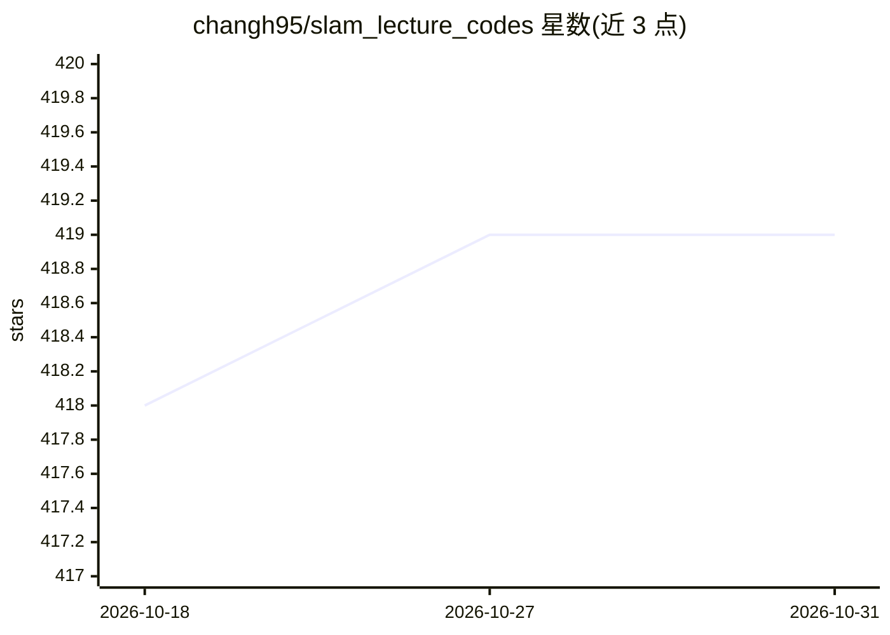

# changh95/slam_lecture_codes

⭐ 419 · C++ · 推送 2026-10-30 · [GitHub](https://github.com/changh95/slam_lecture_codes) · 个人维护

**SLAM 系列课程的配套代码练习仓库**

个人讲师在 FastCampus 平台开设的两门课程（自动驾驶 CV/LiDAR/传感器融合、面向 Physical AI 与 3D 视觉的 SLAM 系列）的代码练习合集，覆盖图像处理、点云处理、多视几何、VSLAM、LiDAR SLAM、SLAM CI/CD 等章节，涉及 OpenCV、Eigen、Ceres、g2o、PCL 等库。README 声明仓库正在重构、将持续新增教程。基础 Docker 镜像内列出所用库清单。

## 筛选速览

| 维度 | 判定 | 备注 |
|---|---|---|
| AI 角色 | `ai-knowledge` | 知识聚合/清单类 |
| 许可风险 | `none` | — |
| 部署形态 | `None` |  |
| 模型依赖 | — | README 未给出锁定关系 |
| 硬件要求 | — | 无带数字的原话,不猜 |
| 安装摩擦 | `low` | 无编译、无系统依赖或容器化 |
| 成熟度 | `idea` | |

## 能力要点

- 覆盖 8 章内容：从 3D 空间、图像/点云处理到 VSLAM 与 LiDAR SLAM
- 基础 Docker 镜像集成 OpenCV/Eigen/Sophus/Ceres/g2o/GTSAM/PCL 等库
- 包含 Superpoint/Superglue（TensorRT）、PyTorch/TensorFlow 学习类特征等 AI 相关练习
- 含 SLAM 项目 CI/CD、TDD 测试章节与最终项目（DSP-SLAM、Suma++ 等）

## 适用场景

- 跟随 SLAM 课程做配套代码练习
- 查找各 SLAM 算法库（Ceres、g2o、PCL 等）的示例用法
- 学习 SLAM 项目的工程化与 CI/CD 实践

## 场景标签

`教程课程` · 领域:学习与行业

## 证据(README 行号)

> L3: This repository contains code exercises for the following lecture series provided by @changh95 at FastCampus:
> L6: - 'SLAM Zero-to-Hero series for Physical AI and 3D Computer Vision'

## 星数曲线

2026-10-18 418 → 2026-10-31 419（+1）

---
*卡片 v1 · prompt 1.4 · 生成 2026-10-21 · 置信度 high · 依据 README sha `069c8fd4ca33` · [字段定义](../../DATASET.md)*
