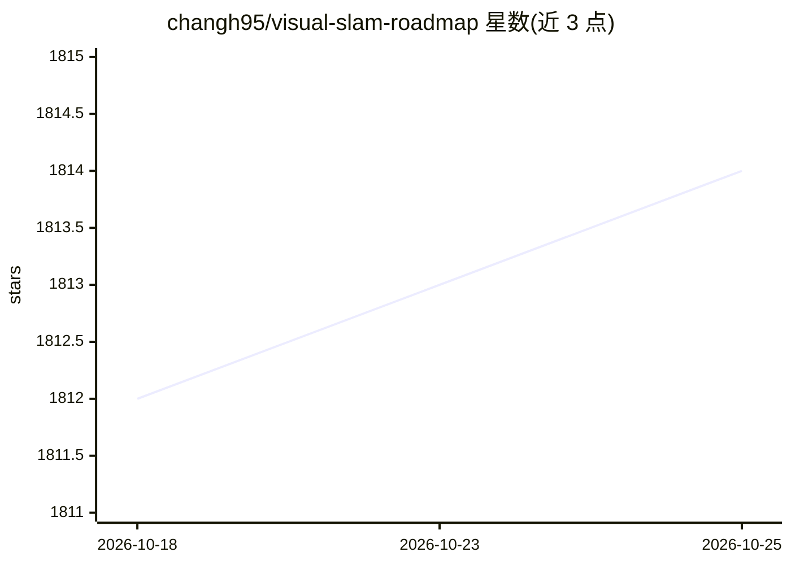

# changh95/visual-slam-roadmap

⭐ 1,814 · Astro · MIT · 推送 2026-07-19 · [GitHub](https://github.com/changh95/visual-slam-roadmap) · [官网](https://www.cv-learn.com/visual-slam-roadmap/) · 个人维护

**视觉 SLAM 开发者学习路线图（2026），面向入门者到工程师**

由个人维护的 Visual-SLAM 学习路线图：按 Level 1 入门（C++、线性代数、射影几何）到 Level 4 RGB-D SLAM 分级组织知识点，以表格形式梳理各 SLAM 系统（MonoSLAM、ORB-SLAM 系列、DSO、COLMAP 等）的作者、年份与核心概念，并覆盖因子图优化、传感器融合、评测数据集与工具。面向希望成为 Visual-SLAM 工程师或研究者的初学者，特别是非英语课程稀缺环境下的学习者。内容为纯阅读材料，不含可安装运行的代码。

## 筛选速览

| 维度 | 判定 | 备注 |
|---|---|---|
| AI 角色 | `ai-knowledge` | 知识聚合/清单类 |
| 许可风险 | `permissive` | MIT |
| 部署形态 | `None` |  |
| 模型依赖 | — | README 未给出锁定关系 |
| 硬件要求 | — | 无带数字的原话,不猜 |
| 安装摩擦 | `high` | 编译与系统依赖俱全 |
| 成熟度 | — | 结构信号不足 |

## 能力要点

- 分级学习路径：入门数学/几何 → SLAM 核心概念 → 单目/RGB-D SLAM
- 以表格梳理数十个 SLAM 系统的方法谱系与关键概念
- 覆盖深度学习特征（SuperPoint/SuperGlue）与动态环境 SLAM 方向
- 列举 KITTI/TUM/EuRoC 等评测数据集与 evo 工具

## 适用场景

- 初学者规划从零到 SLAM 工程师的系统学习路径
- 按主题查找经典 SLAM 论文与系统的核心概念
- 了解深度学习方法在 SLAM 中的应用方向

## 场景标签

`精选清单` `教程课程` · 领域:学习与行业

## 证据(README 行号)

> L7: Below is a set of topics you need to understand for Visual-SLAM, ranging from absolute-beginner level to getting rea
> L13: I made this roadmap to share my thoughts and experience on studying Visual-SLAM, and hopefully beginners can get a 

## 星数曲线

2026-10-18 1,812 → 2026-10-25 1,814（+2）

---
*卡片 v1 · prompt 1.4 · 生成 2026-10-21 · 置信度 high · 依据 README sha `8bd0b16f34ee` · [字段定义](../../DATASET.md)*
