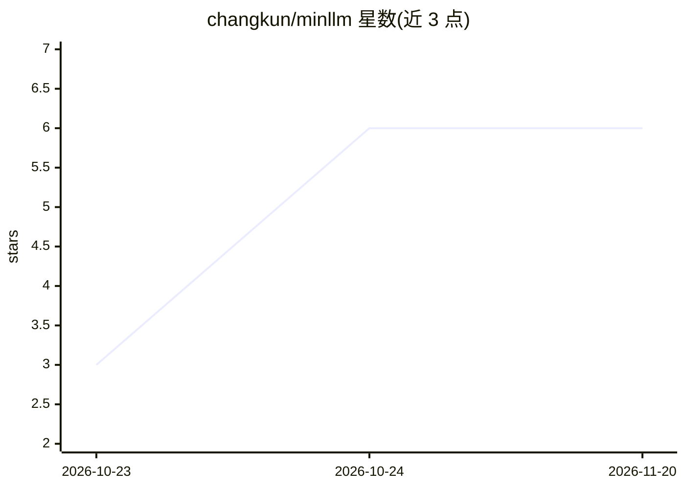

# changkun/minllm

⭐ 6 · JavaScript · MIT · 推送 2026-10-15 · [GitHub](https://github.com/changkun/minllm) · [官网](https://minllm.latere.site) · 个人维护

**为学习者提供的从零实现 LLM 全流程教学管线**

一个以可读为目标的极简语言模型管线，从原始文本出发依次构建 tokenizer、预训练模型、推理引擎、微调对话模型，以及经 RLHF 与 RLVR 后训练的模型，共十个阶段，各阶段附讲解笔记、代码与测试。除 PyTorch 外全部自行实现，不依赖 transformers/vllm 等库；另附 MoE、长上下文、蒸馏、量化等分支专题，并在 MacBook 笔记本上给出实测结果，配交互式网站与视频。

## 筛选速览

| 维度 | 判定 | 备注 |
|---|---|---|
| AI 角色 | `ai-knowledge` | 知识聚合/清单类 |
| 许可风险 | `permissive` | MIT |
| 部署形态 | `None` |  |
| 模型依赖 | — | README 未给出锁定关系 |
| 硬件要求 | — | 无带数字的原话,不猜 |
| 安装摩擦 | `medium` | 含编译或系统依赖之一 |
| 成熟度 | — | 结构信号不足 |

## 能力要点

- 十个阶段覆盖 tokenizer、预训练、推理、微调到 RLHF/RLVR 全流程，每阶段含笔记、代码与测试
- 仅依赖 PyTorch，其余组件自行实现，无 transformers/tokenizers/peft/trl/vllm
- 同一模型代码可加载 Qwen2.5-0.5B-Instruct 权重并导出为其他工具可读格式，可在 MLX 运行
- 附 MoE、YaRN 长上下文、MLA、蒸馏、投机解码、GRPO 等分支专题及实测数据

## 适用场景

- 想从零理解 LLM 从预训练到 RLHF 各阶段的原理与实现
- 在笔记本上复现小规模模型训练与后训练实验
- 对照参考实现验证对 Qwen2.5 等权重格式的理解

## 场景标签

`教程课程` `模型训练` `微调` `强化学习` · 领域:学习与行业

## 证据(README 行号)

> L4: laptop and written to be read. It goes from raw text to a tokenizer, a
> L33: is no `transformers`, `tokenizers`, `peft`, `trl` or `vllm` underneath.

## 星数曲线

2026-10-23 3 → 2026-11-20 6（+3）

---
*卡片 v1 · prompt 1.4 · 生成 2026-11-20 · 置信度 high · 依据 README sha `67a518156a34` · [字段定义](../../DATASET.md)*
