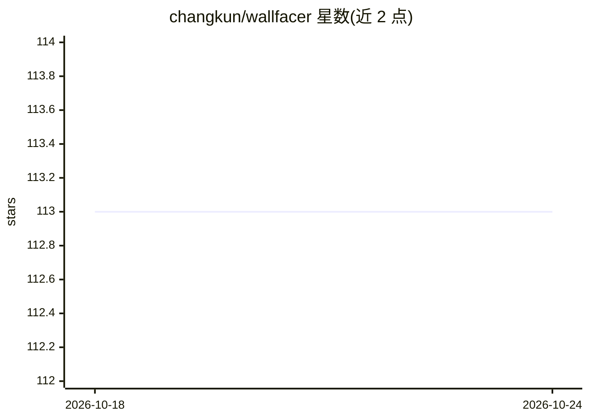

# changkun/wallfacer

⭐ 113 · Go · MIT · 推送 2026-10-23 · [GitHub](https://github.com/changkun/wallfacer) · 个人维护

**本地运行的自主工程平台：协调 AI agent 完成聊天、规格、任务到代码**

用 Go 编写的自主工程平台，把对话探索、结构化规格、任务板与代码编辑整合为连续工作流。规格作为中间表示被 agent 读取、迭代并派发为任务；每个任务在独立 git worktree 中以宿主进程执行，可并行，支持按任务调节自主程度。通过可插拔 harness 层接入 Claude Code、Codex、Cursor、OpenCode、Pi，自带浏览器界面、审计时间线与 token/成本追踪。开源本地运行，不锁定云端。

## 筛选速览

| 维度 | 判定 | 备注 |
|---|---|---|
| AI 角色 | `ai-ecosystem` | LLM/agent 周边工具 |
| 许可风险 | `permissive` | MIT |
| 部署形态 | `None` |  |
| 模型依赖 | — | README 未给出锁定关系 |
| 硬件要求 | — | 无带数字的原话,不猜 |
| 安装摩擦 | `low` | 无编译、无系统依赖或容器化 |
| 成熟度 | `idea` | |

## 能力要点

- 规格七状态生命周期与依赖 DAG，可原子派发与撤销
- 每任务独立 git worktree，支持并行 agent 执行
- 可插拔 harness 层支持 Claude Code/Codex/Cursor/OpenCode/Pi
- 每任务记录 token 用量与成本，提供 oversight 摘要与事件时间线

## 适用场景

- 把想法从对话逐步推进到规格、任务并自动实现提交
- 并行调度多个 coding agent 并在任意环节介入审查
- 追踪每个 agent 任务的成本、diff 与执行过程

## 场景标签

`编码 Agent` `Agent 框架` · 领域:Agent 开发

## 证据(README 行号)

> L41: **Harness flexibility.** Works with Claude Code, Codex, Cursor, OpenCode, and Pi through a pluggable harness layer.
> L101: - **Agent roles** carry the pipeline: impl, test, commit-msg, title, and oversight. Each runs on the task's harnes
> L13: Wallfacer is an autonomous engineering platform that works across multiple levels of abstraction. Start with a conv

## 星数曲线

2026-10-18 113 → 2026-10-24 113（+0）

---
*卡片 v1 · prompt 1.4 · 生成 2026-10-23 · 置信度 high · 依据 README sha `7c6bb65148be` · [字段定义](../../DATASET.md)*
