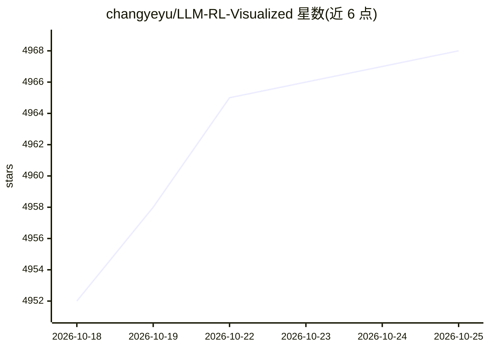

# changyeyu/LLM-RL-Visualized

⭐ 4,970 · Python · NOASSERTION · 推送 2026-09-10 · [GitHub](https://github.com/changyeyu/LLM-RL-Visualized) · [官网](https://book.douban.com/subject/37331056/) · 个人维护 · 中文 README

**100+ 张原创 LLM/RL/VLM 原理架构图的知识图谱仓库**

由《大模型算法：强化学习、微调与对齐》作者维护的图解知识仓库：以 100+ 张原创架构图系统讲解大模型与强化学习技术，内容分 11 个部分，覆盖 LLM 结构与解码、SFT（LoRA/Prefix-Tuning 等）、DPO、免训练优化（CoT/RAG/Function Calling/各种解码采样策略）以及强化学习基础（MDP、策略梯度、PPO/GRPO 等）。图片提供高清大图与 SVG 矢量格式，仓库长期勘误追加；更详细解读指向作者的图书。

## 筛选速览

| 维度 | 判定 | 备注 |
|---|---|---|
| AI 角色 | `ai-knowledge` | 知识聚合/清单类 |
| 许可风险 | `none` | NOASSERTION |
| 部署形态 | `None` |  |
| 模型依赖 | — | README 未给出锁定关系 |
| 硬件要求 | — | 无带数字的原话,不猜 |
| 安装摩擦 | `low` | 无编译、无系统依赖或容器化 |
| 成熟度 | — | 结构信号不足 |

## 能力要点

- 100+ 张原创架构图，覆盖 LLM/VLM 结构、训练算法（RLHF/DPO/GRPO/SFT）与 RL 基础
- 内容按 11 个部分组织，从大模型基础到策略优化与推理能力优化
- 提供 .svg 矢量图（可无限缩放、可选择文字）
- 仓库长期勘误与追加内容

## 适用场景

- 系统学习大模型与强化学习的算法原理
- 查找某个具体算法（如 LoRA、DPO、Top-P 采样）的原理图用于学习或讲解
- 作为大模型训练相关课程或分享的图示素材来源

## 场景标签

`教程课程` · 领域:学习与行业

## 证据(README 行号)

> L21: 🎉 **原创 100+ 架构图，系统讲解大模型、强化学习**，涵盖：LLM / VLM 等大模型原理、训练算法（RL、RLHF、GRPO、DPO、SFT 与 CoT 蒸馏等）、效果优化与 RAG 等。
> L23: 🎉 关于架构图 更详细 的解读可参考：《大模型算法：强化学习、微调与对齐》 (豆瓣高分，多次京东AI图书Top 5 ！)
> L27: 🎉 单击图片可看高清大图，或浏览仓库目录中的 `.svg` 格式矢量图（活图，可无限缩放、可选择文字）

## 星数曲线

2026-10-18 4,952 → 2026-10-25 4,968（+16）

---
*卡片 v1 · prompt 1.4 · 生成 2026-10-20 · 置信度 high · 依据 README sha `e4e657c3db3f` · [字段定义](../../DATASET.md)*
