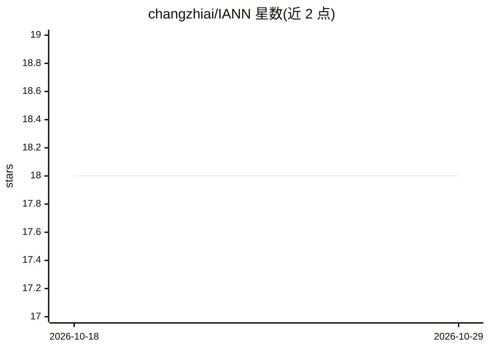

# changzhiai/IANN

⭐ 18 · Python · MIT · 推送 2026-09-23 · [GitHub](https://github.com/changzhiai/IANN) · [官网](https://iann.readthedocs.io) · 组织维护

**等变原子间神经网络势框架：预测材料与分子的能量和力**

面向材料科学与计算化学的等变原子间神经网络势框架，实现 PaiNN、NequIP、MACE、EquiformerV2/V3、Allegro、UMA、FastPot 等多种图神经网络架构，用于预测周期与非周期体系的能量和力。所有架构共用单一数据对象与单一 Trainer，切换模型仅需改配置字典中的一个词。支持多 GPU 与多节点分布式训练（SLURM/PBS/MPI），提供九个预训练 PaiNN 基础模型（PBE/RPBE/r2SCAN 三个 DFT 级别），并集成 ASE 计算器与 LAMMPS 分子动力学接口（含多 GPU 推理与集成模型）。另提供面向 AI agent 的 MCP 服务器与 Claude Code 技能接口。以 Python 包发布于 PyPI（发行名 pyiann），MIT 许可，需 Python 3.8+ 与 PyTorch 1.9+，GPU 加速需 CUDA。

## 筛选速览

| 维度 | 判定 | 备注 |
|---|---|---|
| AI 角色 | `ai-native` | 本体是模型或模型工具 |
| 许可风险 | `permissive` | MIT |
| 部署形态 | `library` | 以包/库形式分发 |
| 模型依赖 | — | README 未给出锁定关系 |
| 硬件要求 | — | 无带数字的原话,不猜 |
| 安装摩擦 | `medium` | 含编译或系统依赖之一 |
| 成熟度 | — | 结构信号不足 |

## 能力要点

- 单一 Trainer 与数据对象统一 8 种等变架构（PaiNN/NequIP/MACE/EquiformerV2/V3/Allegro/UMA/FastPot），切换模型仅需改配置一个词
- 九个预训练 PaiNN 基础模型，覆盖 PBE/RPBE/r2SCAN 三个 DFT 级别，从 HuggingFace Hub 下载并缓存
- 多 GPU/多节点分布式训练，自动从 SLURM/PBS/MPI 环境变量获取并行参数
- LAMMPS 接口支持 GPU 与多 GPU 推理，可导出集成模型与不确定性评估计算器

## 适用场景

- 训练机器学习势函数预测材料的能量与力
- 用预训练基础模型开箱即做预测或在自己的数据上微调
- 把 IANN 模型接入 LAMMPS 跑分子动力学模拟
- 在 SLURM/PBS 集群上多节点训练大模型

## 场景标签

`微调` `模型训练` · 领域:训练与推理

## 证据(README 行号)

> L15: IANN (InterAtomic Neural Network) framework is an equivariant interatomic neural network potential framework packag
> L20: - High-accuracy energy and force predictions

## 星数曲线

2026-10-18 18 → 2026-10-29 18（+0）

---
*卡片 v1 · prompt 1.4 · 生成 2026-10-29 · 置信度 high · 依据 README sha `cab1251ca557` · [字段定义](../../DATASET.md)*
