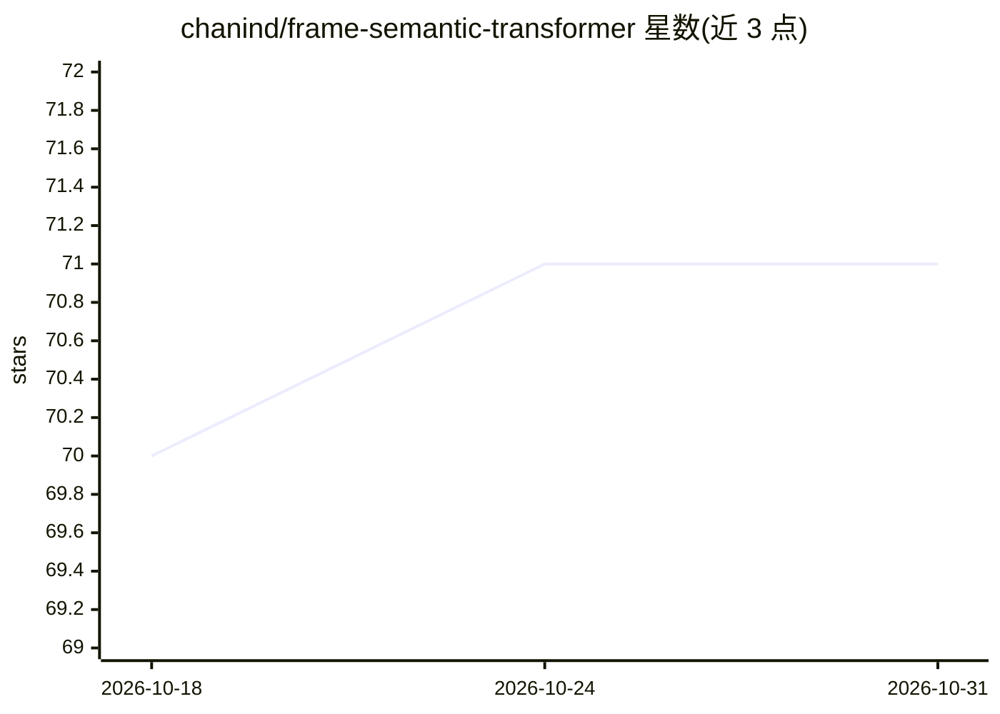

# chanind/frame-semantic-transformer

⭐ 71 · Python · MIT · 推送 2026-08-10 · [GitHub](https://github.com/chanind/frame-semantic-transformer) · [官网](https://chanind.github.io/frame-semantic-transformer) · 个人维护

**基于 T5 的 FrameNet 框架语义解析库，供 NLP 开发者使用**

基于 HuggingFace T5 训练的框架语义解析 Python 库，在 FrameNet 1.7 上训练，提供 base 与 small 两个预训练模型，可执行触发词识别、框架分类与论元抽取；训练与评估方法借鉴 Open-Sesame 并沿用其数据划分，支持批量推理、GPU/CPU 切换及加载本地微调 T5 模型。限制：训练仅使用单句，不建议一次输入多句。代码 MIT 许可，预训练模型为 Apache 2.0。

## 筛选速览

| 维度 | 判定 | 备注 |
|---|---|---|
| AI 角色 | `ai-native` | 本体是模型或模型工具 |
| 许可风险 | `permissive` | MIT |
| 部署形态 | `library` | 以包/库形式分发 |
| 模型依赖 | — | README 未给出锁定关系 |
| 硬件要求 | — | 无带数字的原话,不猜 |
| 安装摩擦 | `low` | 无编译、无系统依赖或容器化 |
| 成熟度 | — | 结构信号不足 |

## 能力要点

- 提供 base/small 两个基于 t5-base/t5-small 的预训练模型
- detect_frames() 输出触发词位置、FrameNet 框架名与框架元素
- detect_frames_bulk() 批量处理（默认 batch_size=8）
- 自动检测 GPU，可用 use_gpu 参数显式指定 CPU/GPU

## 适用场景

- 对句子做 FrameNet 框架语义解析，抽取触发词与框架元素
- 在 NLP 流程中批量处理句子级别的语义结构标注
- 加载自定义微调 T5 模型做框架解析推理

## 场景标签

 · 领域:NLP/语义解析

## 证据(README 行号)

> L6: Frame-based semantic parsing library trained on FrameNet and built on HuggingFace's T5 Transformer
> L40: The main entry to interacting with the library is the `FrameSemanticTransformer` class, as shown below. For inferen

## 星数曲线

2026-10-18 70 → 2026-10-31 71（+1）

---
*卡片 v1 · prompt 1.4 · 生成 2026-10-24 · 置信度 high · 依据 README sha `77ab21694800` · [字段定义](../../DATASET.md)*
