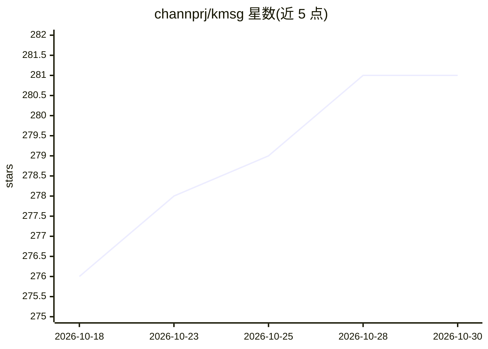

# channprj/kmsg

⭐ 281 · Swift · MIT · 推送 2026-09-21 · [GitHub](https://github.com/channprj/kmsg) · [官网](https://channprj.github.io/kmsg/) · 个人维护

**macOS 非官方 KakaoTalk CLI 与原生 MCP 服务器**

面向 macOS 用户的非官方 KakaoTalk 命令行工具与原生 stdio MCP 服务器，通过 macOS Accessibility API（AXUIElement/CGEvent）控制本地 KakaoTalk 界面，实现聊天列表查询、消息读取、实时监视与文本/图片发送，输出结构化 JSON。内置 MCP 服务器向 AI agent 提供读/发工具，并附带 Claude Code 与 Codex 可安装的技能包。要求 macOS 13+、macOS 版 KakaoTalk 及辅助功能权限；不连接 Kakao 服务器或 LOCO 协议，UI 结构变更可能影响路径。KakaoTalk UI 变更可能导致部分导航路径失效。

## 筛选速览

| 维度 | 判定 | 备注 |
|---|---|---|
| AI 角色 | `ai-ecosystem` | LLM/agent 周边工具 |
| 许可风险 | `permissive` | MIT |
| 部署形态 | `library` | 以包/库形式分发 |
| 模型依赖 | — | README 未给出锁定关系 |
| 硬件要求 | — | 无带数字的原话,不猜 |
| 安装摩擦 | `low` | 无编译、无系统依赖或容器化 |
| 成熟度 | — | 结构信号不足 |

## 能力要点

- 基于 macOS Accessibility API 控制本机 KakaoTalk，读取/监视/发送文本与图片
- 原生 stdio MCP 服务器，提供读取、文本发送、图片发送工具
- 结构化 JSON 输出至 stdout，AX 追踪日志分离至 stderr
- self-healing AX 路径缓存与复用 chat_id，附 Claude Code/Codex 技能包

## 适用场景

- 用脚本或命令行读取、监视和发送 KakaoTalk 消息
- 让 AI agent 通过 MCP 工具操作 KakaoTalk 聊天（发送前 dry-run 确认）
- 在 macOS 上构建本机消息自动化流程

## 场景标签

`GUI 自动化` `工作流自动化` · 领域:效率与自动化

## 证据(README 行号)

> L69: - 읽기, 텍스트 전송, 이미지 전송 도구를 제공하는 native stdio MCP 서버를 실행합니다.
> L173: 네. 네이티브 `kmsg mcp-server` 명령은 MCP 호환 클라이언트와 AI

## 星数曲线

2026-10-18 276 → 2026-10-30 281（+5）

---
*卡片 v1 · prompt 1.4 · 生成 2026-10-22 · 置信度 mid · 依据 README sha `951faf8e2bd3` · [字段定义](../../DATASET.md)*
