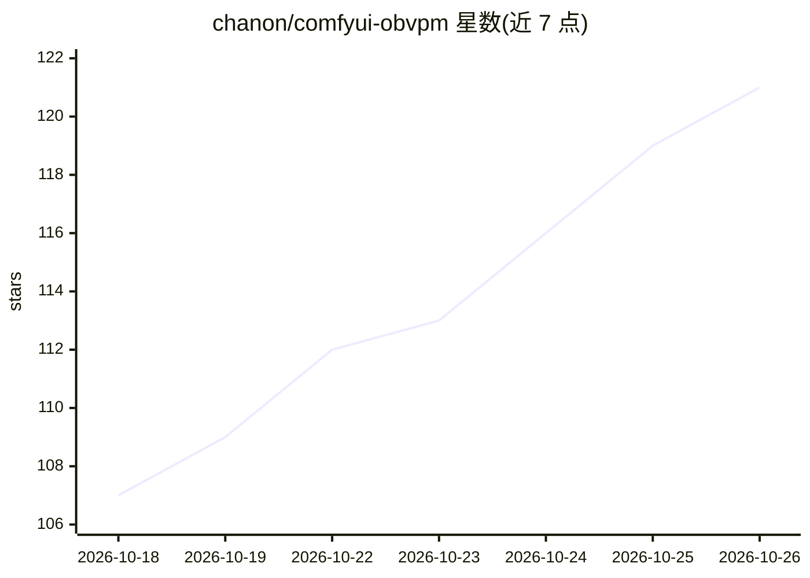

# chanon/comfyui-obvpm

⭐ 121 · JavaScript · GPL-3.0 · 推送 2026-10-23 · [GitHub](https://github.com/chanon/comfyui-obvpm) · 个人维护

**ComfyUI 自定义节点包：线束打包、预设与图像合成等整理工具**

面向 ComfyUI 工作流使用者的节点包（obvpm），提供将多根连线打包为单线的 Bundle/Unbundle、可编辑模板的 Value Presets 预设节点、带交互裁剪编辑器的 Load Image & Crop、把多张图合成一张参考图的 Load Images & Compose，以及门控/开关类节点（Lazy Switch、Mute If 等）、Compatibility Check 和 Clean VRAM 等杂项节点。安装方式为克隆到 ComfyUI/custom_nodes 目录后重启，无需额外 Python 依赖。节点在菜单中以 (obvpm) 后缀统一检索。

## 筛选速览

| 维度 | 判定 | 备注 |
|---|---|---|
| AI 角色 | `ai-ecosystem` | LLM/agent 周边工具 |
| 许可风险 | `viral` | GPL-3.0 |
| 部署形态 | `None` |  |
| 模型依赖 | — | README 未给出锁定关系 |
| 硬件要求 | — | 无带数字的原话,不猜 |
| 安装摩擦 | `low` | 无编译、无系统依赖或容器化 |
| 成熟度 | — | 结构信号不足 |

## 能力要点

- Bundle/Unbundle 将多个值打包到一根连线并在下游展开
- Value Presets 从可编辑模板生成命名预设并可按运行覆盖
- Load Images & Compose 多图层裁剪合成单张参考图（含百万像素上限）
- 门控与开关节点：Lazy Switch、Mute If、Compatibility Check 等

## 适用场景

- 整理复杂 ComfyUI 工作流，减少连线数量
- 为工作流参数创建可切换的预设组合
- 把多张参考图裁剪合成一张送入模型

## 场景标签

`图像生成` · 领域:内容生成

## 证据(README 行号)

> L3: ComfyUI nodes to save time and keep your workflows tidy. Bundle multiple wires into one wire. Create customizable pr
> L57: git clone https://github.com/chanon/comfyui-obvpm

## 星数曲线

2026-10-18 107 → 2026-10-26 121（+14）

---
*卡片 v1 · prompt 1.4 · 生成 2026-10-23 · 置信度 high · 依据 README sha `a40b391fa04c` · [字段定义](../../DATASET.md)*
