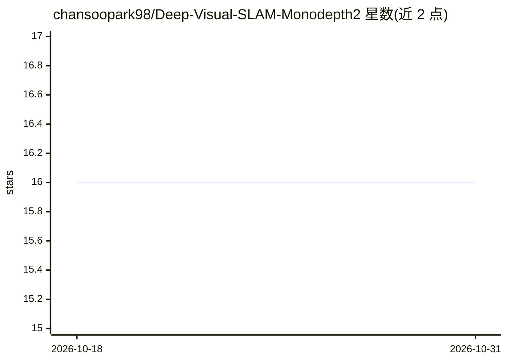

# chansoopark98/Deep-Visual-SLAM-Monodepth2

⭐ 16 · C++ · MIT · 推送 2026-01-07 · [GitHub](https://github.com/chansoopark98/Deep-Visual-SLAM-Monodepth2) · 个人维护

**单目视觉 SLAM 系统：自监督深度估计+位姿估计**

基于 Monodepth2 的深度学习单目视觉里程计实现：以 ResNet-18 编码器-解码器构建深度网络与位姿网络，通过光度一致性损失（SSIM+L1）联合自监督训练，无需深度或位姿真值标签。支持 Redwood RGBD、NYU Depth V2 与自定义数据集训练；推理脚本从单目序列生成深度图、相机轨迹与三维点云可视化，并提供轨迹（ATE/RPE）与深度（AbsRel/RMSE 等）评估脚本。运行需 Ubuntu 22.04、CUDA 12.8、PyTorch 2.8+，训练与推理均通过 YAML 配置文件控制。

## 筛选速览

| 维度 | 判定 | 备注 |
|---|---|---|
| AI 角色 | `ai-native` | 本体是模型或模型工具 |
| 许可风险 | `permissive` | MIT |
| 部署形态 | `library` | 以包/库形式分发 |
| 模型依赖 | — | README 未给出锁定关系 |
| 硬件要求 | — | 无带数字的原话,不猜 |
| 安装摩擦 | `medium` | 含编译或系统依赖之一 |
| 成熟度 | — | 结构信号不足 |

## 能力要点

- 深度与位姿网络联合自监督训练（光度损失，无需真值标签）
- ResNet-18 编码器的单目深度估计与视觉里程计
- 实时三维点云生成与轨迹可视化输出
- 支持 Redwood RGBD / NYU Depth V2 / 自定义 RGB-D 数据集

## 适用场景

- 在单目视频序列上估计相机自运动与轨迹
- 无需标注数据训练单目深度估计模型
- 生成带轨迹叠加的 3D 点云可视化视频

## 场景标签

`图像视频处理` · 领域:感知与多模态

## 证据(README 行号)

> L11: This repository implements a **deep learning-based Monocular Visual SLAM (Visual Odometry)** system based on Monode
> L15: - **Self-Supervised Learning**: Joint training of depth and pose networks using photometric loss (SSIM + L1)

## 星数曲线

2026-10-18 16 → 2026-10-31 16（+0）

---
*卡片 v1 · prompt 1.4 · 生成 2026-10-30 · 置信度 high · 依据 README sha `c0156f648f86` · [字段定义](../../DATASET.md)*
