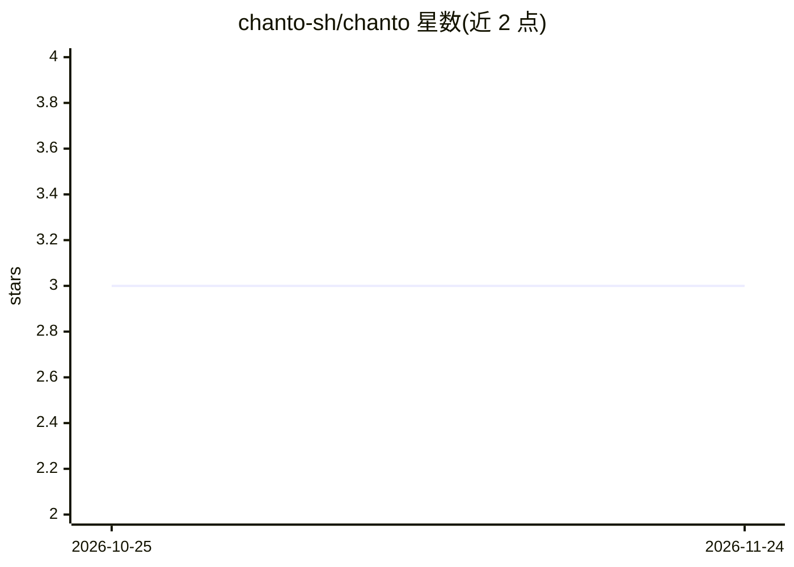

# chanto-sh/chanto

⭐ 3 · Rust · Apache-2.0 · 推送 2026-11-24 · [GitHub](https://github.com/chanto-sh/chanto) · [官网](https://chanto.sh) · 组织维护

**终端里的编程 Agent CLI，可接本地或云端多种模型**

用 Rust 编写的终端编程 Agent：在项目目录中启动会话，以自然语言驱动代码修改与命令执行，编辑文件和运行高风险命令前默认询问。支持本地与云端多种模型来源，可读取已有的 Claude Code 与 Codex 配置（设置、MCP、指令文件、技能等）。提供权限模式、会话回滚/分叉、--verify 完成前校验、后台任务、多 agent 协作、MCP 扩展与 token/成本统计。当前处于 alpha 阶段，1.0 前可能有破坏性变更。

## 筛选速览

| 维度 | 判定 | 备注 |
|---|---|---|
| AI 角色 | `ai-ecosystem` | LLM/agent 周边工具 |
| 许可风险 | `permissive` | Apache-2.0 |
| 部署形态 | `library` | 以包/库形式分发 |
| 模型依赖 | local-ok | 支持本地模型 |
| 硬件要求 | — | 无带数字的原话,不猜 |
| 安装摩擦 | `low` | 无编译、无系统依赖或容器化 |
| 成熟度 | `idea` | |

## 能力要点

- 支持本地 OpenAI 兼容服务器与多家云端模型接入
- 读取 Claude Code / Codex 的既有配置（settings、MCP、AGENTS.md 等）
- 提供 --verify 校验门与测试弱化防护
- 支持会话回滚、worktree 后台任务与多 agent 分工

## 适用场景

- 在终端用自然语言让 Agent 修复失败的测试
- 通过 Ollama 或 OpenAI 兼容服务器用本地模型跑编程 Agent
- 复用已有的 Claude Code 配置切换到该工具
- 在 CI 中以 -p 模式单次运行编程任务

## 场景标签

`编码 Agent` `多智能体` · 领域:Agent 开发

## 证据(README 行号)

> L5:  A fast, lean coding agent for your terminal.
> L45: Chanto detects API keys, compatible configuration and local model servers, then asks you to pick a model. Use an AP
> L86: |**Extensions**|MCP tools, hooks, skills, custom commands and compatible plugin marketplaces|

## 星数曲线

2026-10-25 3 → 2026-11-24 3（+0）

---
*卡片 v1 · prompt 1.4 · 生成 2026-11-22 · 置信度 high · 依据 README sha `4bcc28d2b1ca` · [字段定义](../../DATASET.md)*
