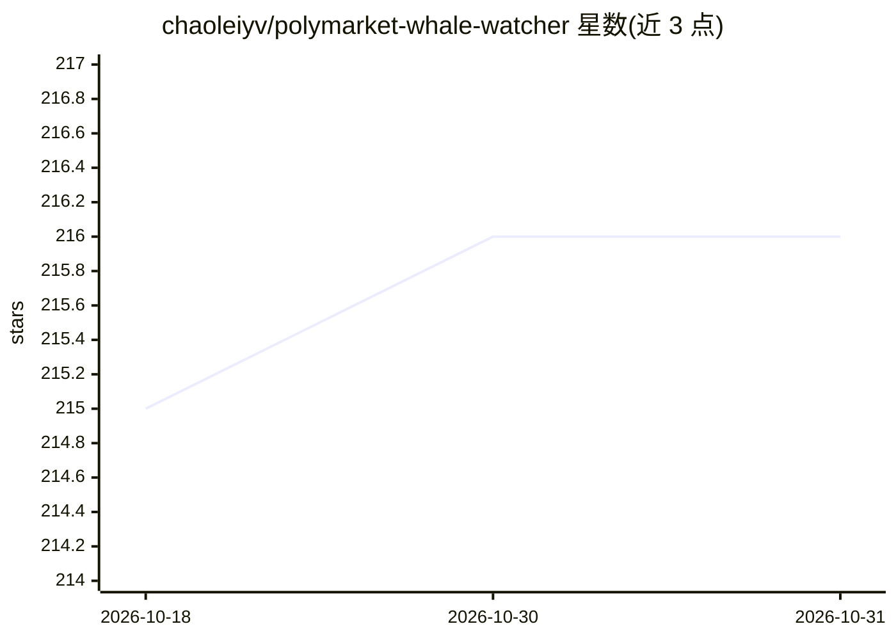

# chaoleiyv/polymarket-whale-watcher

⭐ 216 · Python · 推送 2026-05-06 · [GitHub](https://github.com/chaoleiyv/polymarket-whale-watcher) · 个人维护

**监控 Polymarket 巨额交易的 AI 情报工具，输出信息不对称评分**

Python 3.10+ 程序：实时监控 Polymarket 700+ 活跃市场（按交易量分 3 层轮询），经 5 因子异常评分筛选鲸鱼交易后，部署配有 14 个自主研究工具（Web/Twitter/Telegram/加密/DeFi/股票/链上/立法）的 LLM agent 进行最多 3 轮多步调查，产出 7 步结构化分析报告与 0–1 信息不对称评分 (IAS)。信号每 30 分钟自动核验胜率，每日 10:00 生成邮件简报，附 FastAPI 仪表盘。必需 Gemini API key，模型可换任意 OpenAI 兼容端点；声明仅供研究教育用途。

## 筛选速览

| 维度 | 判定 | 备注 |
|---|---|---|
| AI 角色 | `ai-native` | 本体是模型或模型工具 |
| 许可风险 | `permissive` | — |
| 部署形态 | `self-host` | docker 或自建部署 |
| 模型依赖 | — | README 未给出锁定关系 |
| 硬件要求 | — | 无带数字的原话,不猜 |
| 安装摩擦 | `low` | 无编译、无系统依赖或容器化 |
| 成熟度 | — | 结构信号不足 |

## 能力要点

- 700+ 市场三层分级监控与 5 因子异常检测（阈值 >= 0.65）
- LLM agent 自主选择并链式调用 14 个研究工具，最多 3 轮
- 7 步深度分析产出 0–1 信息不对称评分
- 信号自动核验、每日邮件简报与 FastAPI 绩效仪表盘

## 适用场景

- 跟踪 Polymarket 上的大额异常交易并获取深度分析报告
- 每天收邮件了解高信息不对称信号与历史胜率统计
- 研究预测市场中潜在的信息优势行为

## 场景标签

`金融量化` · 领域:学习与行业

## 证据(README 行号)

> L18: Whale Watcher continuously monitors **700+ active Polymarket markets** across three volume tiers, detects large tra
> L123: |**5. LLM Investigation**|Builds rich context (trade + trader profile + event positions + market top holders + his
> L142: The LLM agent autonomously selects and chains these tools during its multi-round investigation:

## 星数曲线

2026-10-18 215 → 2026-10-31 216（+1）

---
*卡片 v1 · prompt 1.4 · 生成 2026-10-22 · 置信度 high · 依据 README sha `83aba81cea56` · [字段定义](../../DATASET.md)*
