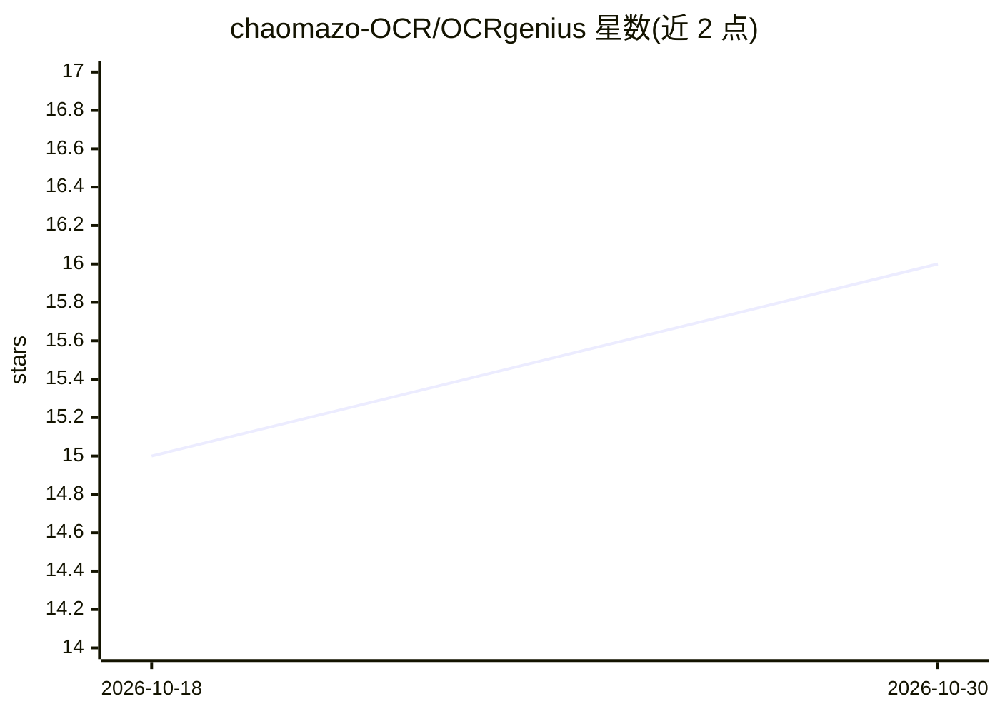

# chaomazo-OCR/OCRgenius

⭐ 16 · TypeScript · MIT · 推送 2026-09-05 · [GitHub](https://github.com/chaomazo-OCR/OCRgenius) · [官网](https://ocrgenius.web.id/) · 组织维护

**面向物流的货运单据 OCR 提取与校验产品**

面向物流公司的单据智能产品：读取提单、CMR、发票、装箱单与报关文件，按上下文提取字段（当事方、重量、日期、行项等），逐字段置信度评分并把不确定值送人工复核，输出 JSON/CSV/Excel 并映射到现有 ERP/TMS/WMS 流程；支持 REST、webhooks、SFTP 等接入方式。当前仓库为 TypeScript monorepo，包含 React 落地页 mockup、Express API 服务基础与 OpenAPI/Zod 契约库；安装运行需 Node.js 20+ 与 pnpm。

## 筛选速览

| 维度 | 判定 | 备注 |
|---|---|---|
| AI 角色 | `ai-native` | 本体是模型或模型工具 |
| 许可风险 | `permissive` | MIT |
| 部署形态 | `library` | 以包/库形式分发 |
| 模型依赖 | — | README 未给出锁定关系 |
| 硬件要求 | — | 无带数字的原话,不猜 |
| 安装摩擦 | `low` | 无编译、无系统依赖或容器化 |
| 成熟度 | — | 结构信号不足 |

## 能力要点

- 上下文感知字段提取，适应手写、印章、倾斜照片等非模板单据
- 逐字段置信度评分与业务规则校验，不确定值路由至人工复核
- 输出 JSON/CSV/Excel 并提供 ERP/TMS/WMS 连接路径
- 客户文档隔离，不进入共享模型训练流程

## 适用场景

- 物流公司批量数字化提单、发票、报关等货运文件
- 把扫描/拍照单据转为可对接 ERP/TMS/WMS 的结构化数据
- 对低置信度字段组织人工复核队列

## 场景标签

`OCR` `文档解析` · 领域:知识与检索

## 证据(README 行号)

> L19: **OCRgenius is built to read that reality.** It extracts the useful facts, validates what matters, makes uncertaint
> L34: - **Context-aware extraction** — identify parties, references, weights, dates, line items, and other fields whereve
> L37: - **Schema-ready output** — return JSON, CSV, or Excel mapped to the shape your team needs.

## 星数曲线

2026-10-18 15 → 2026-10-30 16（+1）

---
*卡片 v1 · prompt 1.4 · 生成 2026-10-30 · 置信度 low · 依据 README sha `56345078416b` · [字段定义](../../DATASET.md)*
