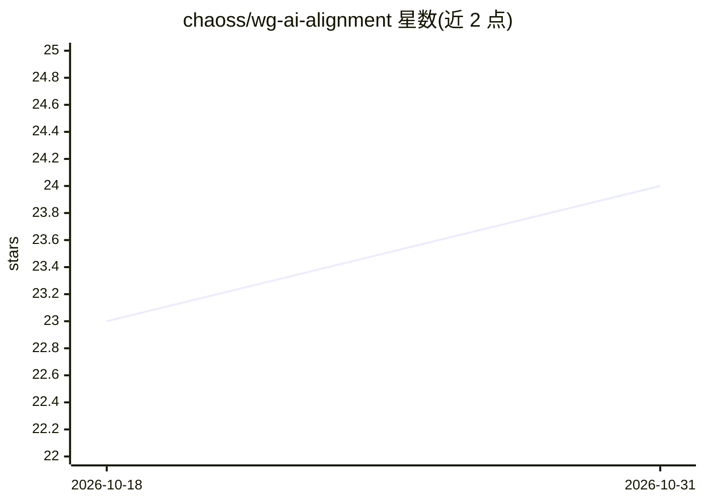

# chaoss/wg-ai-alignment

⭐ 24 · HTML · MIT · 推送 2026-10-30 · [GitHub](https://github.com/chaoss/wg-ai-alignment) · 组织维护

**CHAOSS AI 对齐工作组：协作枢纽与资源清单**

CHAOSS 下 AI Alignment 工作组的规划与协作仓库，工作方向为开发评估 AI 系统对开源社区价值观、期望与项目尊重程度的指标（metrics）。README 说明工作组定位、参与贡献方式（CONTRIBUTING.md），并整理 AI 安全/对齐/伦理的外部资源链接供社区补充。仓库本身不包含代码或可直接运行的指标实现，属于工作组协调与资料汇总载体。

## 筛选速览

| 维度 | 判定 | 备注 |
|---|---|---|
| AI 角色 | `ai-knowledge` | 知识聚合/清单类 |
| 许可风险 | `permissive` | MIT |
| 部署形态 | `None` |  |
| 模型依赖 | — | README 未给出锁定关系 |
| 硬件要求 | — | 无带数字的原话,不猜 |
| 安装摩擦 | `low` | 无编译、无系统依赖或容器化 |
| 成熟度 | — | 结构信号不足 |

## 能力要点

- 面向开源社区的 AI 对齐评估指标研究方向
- 通过 CONTRIBUTING.md 组织社区参与和贡献
- 汇总 AI 安全/对齐/伦理相关外部资源链接

## 适用场景

- 参与制定开源社区视角的 AI 对齐评估指标
- 了解 AI 对齐与 AI 安全领域的相关资料
- 以社区形式跟进 AI 系统对开源生态影响的度量工作

## 场景标签

`精选清单` · 领域:学习与行业

## 证据(README 行号)

> L7: Our working group focuses on AI alignment for open source communities - specifically, on metrics that help evaluate 
> L11: # Context for this Work: Resources on AI Safety, Alignment, and Ethics

## 星数曲线

2026-10-18 23 → 2026-10-31 24（+1）

---
*卡片 v1 · prompt 1.4 · 生成 2026-10-27 · 置信度 mid · 依据 README sha `e56c1fc2952c` · [字段定义](../../DATASET.md)*
