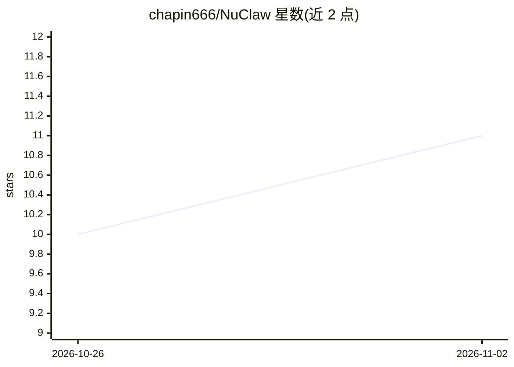

# chapin666/NuClaw

⭐ 11 · C++ · 推送 2026-04-03 · [GitHub](https://github.com/chapin666/NuClaw) · [官网](https://chapin666.github.io/NuClaw/) · 个人维护 · 中文 README

**C++17 从零构建 AI Agent 的渐进式教程项目（21 章）**

面向 C++ 开发者的 AI Agent 教程：从 89 行 Echo 服务器起步，经 21 个 Step 逐章演进到 2000+ 行，覆盖 Boost.Asio 异步网络、Agent Loop、LLM API 接入、工具调用、安全沙箱、RAG 检索、多 Agent 协作、MCP 协议、监控部署与 IM 平台接入；末章以 SmartSupport 智能客服 SaaS 平台（多租户、计费、人机协作）作为综合实战。每章基于前一章，变化可通过 git diff 查看；需用 g++/CMake 自行编译运行。

## 筛选速览

| 维度 | 判定 | 备注 |
|---|---|---|
| AI 角色 | `ai-knowledge` | 知识聚合/清单类 |
| 许可风险 | `none` | — |
| 部署形态 | `None` |  |
| 模型依赖 | — | README 未给出锁定关系 |
| 硬件要求 | — | 无带数字的原话,不猜 |
| 安装摩擦 | `medium` | 含编译或系统依赖之一 |
| 成熟度 | — | 结构信号不足 |

## 能力要点

- 21 章 Step 从 89 行演进到 2000+ 行，git diff 可见每章变化
- 覆盖 Agent Loop、工具系统、安全沙箱、RAG、多 Agent、MCP 协议
- SmartSupport 实战项目：多租户智能客服 SaaS（计费、人机协作、IM 接入）
- C++17 + Boost.Asio + CMake 技术栈，需自行编译

## 适用场景

- 系统学习用 C++ 从零实现 AI Agent 的完整流程
- 了解 Agent 网关的生产化环节（监控、部署、安全沙箱）
- 参照实战项目构建多租户智能客服平台

## 场景标签

`教程课程` · 领域:学习与行业

## 证据(README 行号)

> L3: > 用 C++17 从零构建 AI Agent —— 渐进式教程
> L11: NuClaw 是一个**渐进式 C++ AI Agent 教程项目**。

## 星数曲线

2026-10-26 10 → 2026-11-02 11（+1）

---
*卡片 v1 · prompt 1.4 · 生成 2026-11-02 · 置信度 high · 依据 README sha `3e4606f268ac` · [字段定义](../../DATASET.md)*
