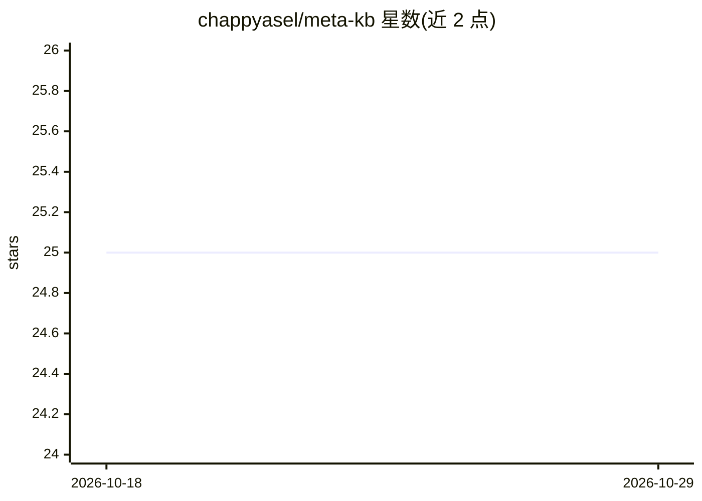

# chappyasel/meta-kb

⭐ 25 · TypeScript · NOASSERTION · 推送 2026-04-09 · [GitHub](https://github.com/chappyasel/meta-kb) · 个人维护

**自我改进的 LLM agent 基础设施知识库/wiki 编译器**

一个关于 LLM agent 基础设施的自改进知识库：用 LLM 从原始来源（142 个策展来源+57 个深度研究文件）编译出 155 篇 wiki 文章与知识图谱，覆盖 6 个分类桶。编译有两条路径：确定性的 Bun 脚本流水线与 agent 原生技能图（6 阶段子 agent 流水线），输出相同结构。自改进循环（评估→分析失败→更新提示→重编译）三轮将声明准确率从 63.9% 提至 80.0%。可 fork 后改一个配置文件编译任意主题的 wiki。

## 筛选速览

| 维度 | 判定 | 备注 |
|---|---|---|
| AI 角色 | `ai-knowledge` | 知识聚合/清单类 |
| 许可风险 | `permissive` | NOASSERTION |
| 部署形态 | `None` |  |
| 模型依赖 | locked-api |  |
| 硬件要求 | — | 无带数字的原话,不猜 |
| 安装摩擦 | `low` | 无编译、无系统依赖或容器化 |
| 成熟度 | — | 结构信号不足 |

## 能力要点

- 自改进循环三轮将原子声明准确率 63.9%→80.0%
- 双编译路径：确定性脚本流水线与 agent 原生技能图
- 增量编译按内容哈希只重编受影响桶与实体
- fork 后仅需编辑 config/domain.ts 即可编译任意主题

## 适用场景

- 查阅 LLM agent 基础设施领域的综述与项目卡片
- fork 该编译器构建自己领域的知识库/wiki
- 对比 agent 原生与确定性编译两种产出

## 场景标签

`知识图谱` `知识库管理` · 领域:知识与检索

## 证据(README 行号)

> L3: A self-improving knowledge base about LLM agent infrastructure.
> L104: - **Wiki:** 155 articles (6 synthesis, 87 project cards, 61 concept explainers, field map, indexes)

## 星数曲线

2026-10-18 25 → 2026-10-29 25（+0）

---
*卡片 v1 · prompt 1.4 · 生成 2026-10-27 · 置信度 high · 依据 README sha `d74003d0dad8` · [字段定义](../../DATASET.md)*
