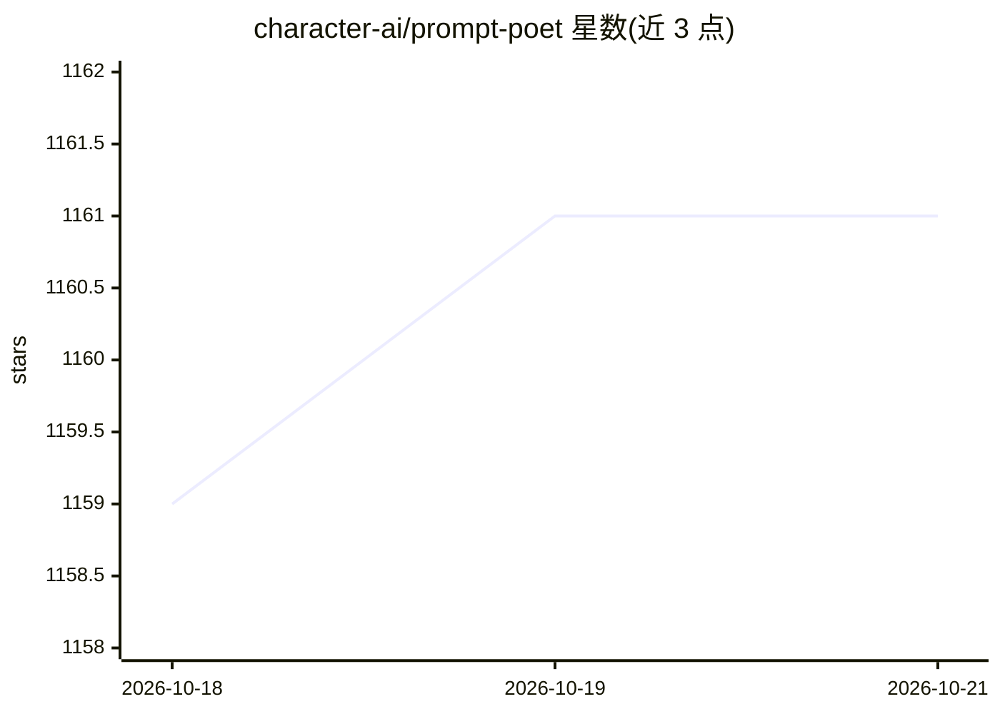

# character-ai/prompt-poet

⭐ — · [GitHub]() · 组织维护

**低代码 prompt 模板库：用 YAML+Jinja2 动态构建 LLM 提示词**

Character.AI 开源的 Python 提示词模板库，面向开发者与非技术用户，以 YAML+Jinja2 混合语法定义提示词模板，支持数据绑定、控制流、模板内函数调用与分节复用。提供分词（默认 TikToken o200k_base，可自定义编码函数）与 cache-aware 截断机制，用于在 token 上限内截断旧消息并提升前缀缓存命中率。模板可存为文件（Template Registry）从磁盘加载。

## 筛选速览

| 维度 | 判定 | 备注 |
|---|---|---|
| AI 角色 | `ai-ecosystem` | LLM/agent 周边工具 |
| 许可风险 | `permissive` | — |
| 部署形态 | `library` | 以包/库形式分发 |
| 模型依赖 | — | README 未给出锁定关系 |
| 硬件要求 | — | 无带数字的原话,不猜 |
| 安装摩擦 | `low` | 无编译、无系统依赖或容器化 |
| 成熟度 | — | 结构信号不足 |

## 能力要点

- YAML+Jinja2 模板：渲染与加载两阶段处理，部件可带 role 与截断优先级
- cache-aware 截断算法，面向前缀缓存命中率优化
- 模板内直接调用任意 Python 函数（如主题分类、少样本示例拉取）
- 嵌套分节支持分段 token 统计

## 适用场景

- 为生产环境 LLM 应用构建可复用、可组合的动态提示词模板
- 对话历史超出 token 上限时按优先级截断旧消息
- A/B 测试时复用模板分节，监控各内容组件的 token 消耗

## 场景标签

`提示工程` · 领域:Agent 开发

## 证据(README 行号)

> L5: Prompt Poet streamlines and simplifies prompt design for both developers and non-technical users with its low code a
> L136: The Prompt Poet Library provides various features and settings, including prompt properties. Key features like tok

## 星数曲线

2026-10-18 1,159 → 2026-10-21 1,161（+2）

---
*卡片 v1 · prompt 1.4 · 生成 2026-10-21 · 置信度 high · 依据 README sha `4adf8a4af785` · [字段定义](../../DATASET.md)*
