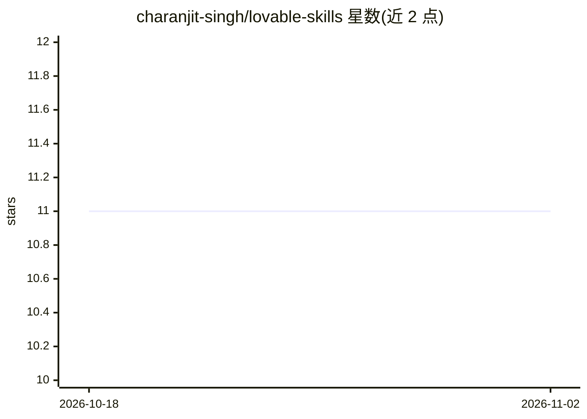

# charanjit-singh/lovable-skills

⭐ 11 · MIT · 推送 2026-05-22 · [GitHub](https://github.com/charanjit-singh/lovable-skills) · [官网](https://vibemastery.io/) · 个人维护

**Lovable 平台的可复用技能库：57 个 Markdown 技能手册**

面向 Lovable.dev 用户的技能（skills）集合：57 个 SKILL.md 格式的短篇 Markdown 手册，覆盖 TanStack Query/Router、Supabase 认证与 RLS、pg_cron 定时任务、Stripe 支付与 webhook、技术与程序化 SEO、shadcn UI、i18n、性能与发布清单等。技能按需加载、不常驻上下文；可通过 GitHub 导入、ZIP 上传或手写方式加入 Lovable 工作区，也兼容 Claude、Cursor 等共享 SKILL.md 形态的 Agent 实现。MIT 许可。

## 筛选速览

| 维度 | 判定 | 备注 |
|---|---|---|
| AI 角色 | `ai-knowledge` | 知识聚合/清单类 |
| 许可风险 | `permissive` | MIT |
| 部署形态 | `None` |  |
| 模型依赖 | — | README 未给出锁定关系 |
| 硬件要求 | — | 无带数字的原话,不猜 |
| 安装摩擦 | `low` | 无编译、无系统依赖或容器化 |
| 成熟度 | — | 结构信号不足 |

## 能力要点

- 57 个按需加载的 SKILL.md 技能，按后端/支付/SEO/UI 等主题组织
- 提供 6 个面向 Lovable + Supabase 项目的入门技能包
- 三种导入方式：GitHub 子目录导入、ZIP 上传、手写表单
- 同一 SKILL.md 形态可移植到 Claude、Cursor 等 Agent Skills 实现

## 适用场景

- 让 Lovable 以一致方式处理 RLS、Stripe webhook 等常见任务
- 为 Lovable + Supabase 项目快速配备发布前检查与 SEO 技能
- 把技能复用到 Cursor 或 Claude 等兼容 Agent Skills 的工具

## 场景标签

`提示工程` · 领域:Agent 开发

## 证据(README 行号)

> L13: A curated collection of **Lovable skills** — short markdown playbooks Lovable loads on demand to handle recurring w
> L20: You can keep dozens of skills in one workspace without bloating context — Lovable only loads the ones that match yo

## 星数曲线

2026-10-18 11 → 2026-11-02 11（+0）

---
*卡片 v1 · prompt 1.4 · 生成 2026-11-02 · 置信度 high · 依据 README sha `41935d05bb5f` · [字段定义](../../DATASET.md)*
