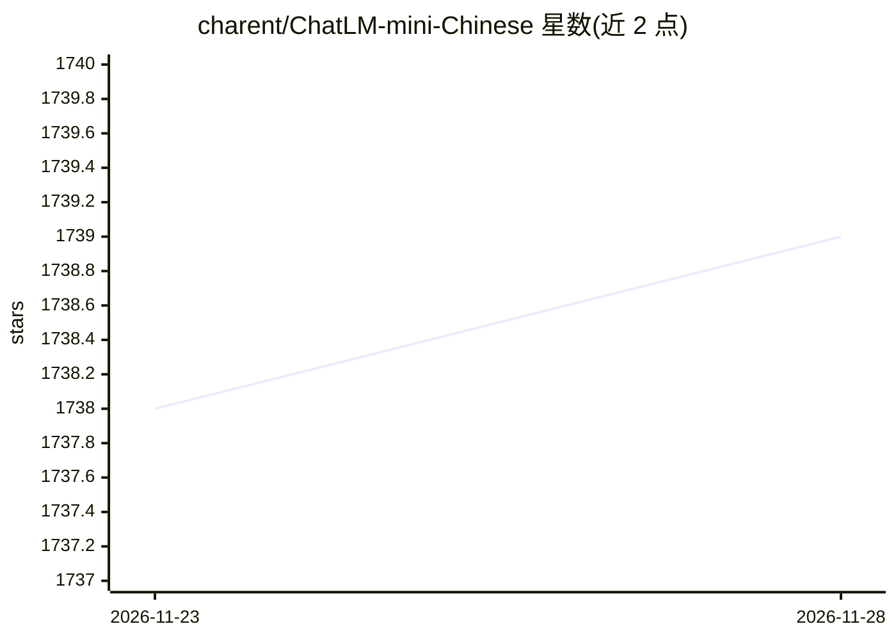

# charent/ChatLM-mini-Chinese

⭐ 1,739 · Python · Apache-2.0 · 推送 2026-11-22 · [GitHub](https://github.com/charent/ChatLM-mini-Chinese) · 个人维护 · 中文 README

**从零训练中文对话0.2B小模型的全流程开源项目**

提供从数据清洗、tokenizer训练、Text-to-Text预训练、SFT指令微调到DPO偏好优化的完整训练代码与模型权重，公开全部数据集来源（1023万条清洗后数据）。基于T5架构（0.2B参数），支持断点续训、单机多卡训练、lora偏好优化与模型合并，附带chatlm-cli流式对话与chatlm-api服务两种推理入口，并给出三元组信息抽取的下游微调示例。预训练最低4GB显存，float16推理仅需512MB。

## 筛选速览

| 维度 | 判定 | 备注 |
|---|---|---|
| AI 角色 | `ai-native` | 本体是模型或模型工具 |
| 许可风险 | `permissive` | Apache-2.0 |
| 部署形态 | `library` | 以包/库形式分发 |
| 模型依赖 | — | README 未给出锁定关系 |
| 硬件要求 | `gpu-8g` | |
| 安装摩擦 | `medium` | 含编译或系统依赖之一 |
| 成熟度 | — | 结构信号不足 |

## 能力要点

- 开源预训练、SFT、DPO全流程代码及数据集来源与清洗过程
- 自实现trainer支持任意位置断点续训与单机多卡训练
- 提供chatlm-cli流式对话与HTTP API两种推理方式
- 给出三元组信息抽取下游任务微调示例

## 适用场景

- 在消费级显卡上从头预训练一个中文对话小模型
- 基于开源权重做SFT或DPO微调实验
- 微调小模型完成三元组抽取等下游任务

## 场景标签

`模型训练` `微调` · 领域:训练与推理

## 证据(README 行号)

> L6: 现在的大语言模型的参数往往较大，消费级电脑单纯做推理都比较慢，更别说想自己从头开始训练一个模型了。本项目的目标是从0开始训练一个生成式语言模型，包括数据清洗、tokenizer训练、模型预训练、SFT指令微调、RLHF优化等。
> L8: ChatLM-mini-Chinese为中文对话小模型，模型参数只有0.2B（算共享权重约210M），可以在最低4GB显存的机器进行预训练（`batch_size=1`，`fp16`或者` bf16`），`float16`加载、推理
> L13: - 预训练：整合为端到端的`Text-to-Text`预训练，非`mask`掩码预测预训练。

## 星数曲线

2026-11-23 1,738 → 2026-11-28 1,739（+1）

---
*卡片 v1 · prompt 1.4 · 生成 2026-11-23 · 置信度 high · 依据 README sha `a237c9481cc7` · [字段定义](../../DATASET.md)*
