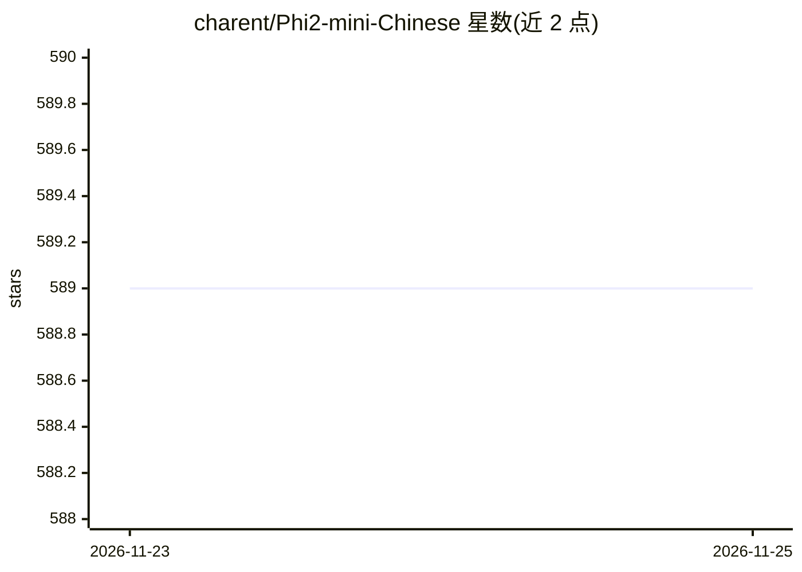

# charent/Phi2-mini-Chinese

⭐ 589 · Jupyter Notebook · Apache-2.0 · 推送 2026-11-22 · [GitHub](https://github.com/charent/Phi2-mini-Chinese) · 个人维护 · 中文 README

**从零预训练 0.2B 中文小模型并支持 RAG 的实验项目**

提供 Phi2 架构 0.2B 中文因果语言模型的完整训练流水线：数据清洗（去重、繁简转换、NFKC 标准化）、BPE tokenizer 训练、CLM 预训练、SFT 指令微调、DPO 偏好优化，各阶段给出脚本与数据格式说明；训练数据使用 BELLE 数据集与百科语料。模型支持 transformers 加载对话，并可经 langchain 搭配 chromadb 做本地知识库检索增强生成。依赖由 pyproject.toml 与 uv.lock 统一管理，按推理/训练/RAG 分组安装。作者自述为实验项目，数据规模有限，建议需要更好效果者参考 ChatLM-mini-Chinese。

## 筛选速览

| 维度 | 判定 | 备注 |
|---|---|---|
| AI 角色 | `ai-native` | 本体是模型或模型工具 |
| 许可风险 | `permissive` | Apache-2.0 |
| 部署形态 | `None` |  |
| 模型依赖 | — | README 未给出锁定关系 |
| 硬件要求 | — | 无带数字的原话,不猜 |
| 安装摩擦 | `medium` | 含编译或系统依赖之一 |
| 成熟度 | `idea` | |

## 能力要点

- 覆盖数据清洗、tokenizer 训练、CLM 预训练、SFT、DPO 全流程脚本
- 支持 flash attention 2 加速
- 提供 langchain + chromadb 的本地知识库 RAG notebook
- 依赖由 pyproject.toml + uv.lock 管理，按 extra 分组安装

## 适用场景

- 学习小语言模型从零预训练到 DPO 的完整流程
- 训练自己的中文对话小模型
- 用 langchain 加载本地知识库做检索增强生成

## 场景标签

`RAG` `微调` `模型训练` · 领域:知识与检索

## 证据(README 行号)

> L1: # Phi2-Chinese-0.2B 从0开始训练自己的Phi2中文小模型
> L9: - 支持flash attention 2 加速
> L138: ## 6.2 检索式生成（RAG）

## 星数曲线

2026-11-23 589 → 2026-11-25 589（+0）

---
*卡片 v1 · prompt 1.4 · 生成 2026-11-23 · 置信度 high · 依据 README sha `fdcbb91af15f` · [字段定义](../../DATASET.md)*
