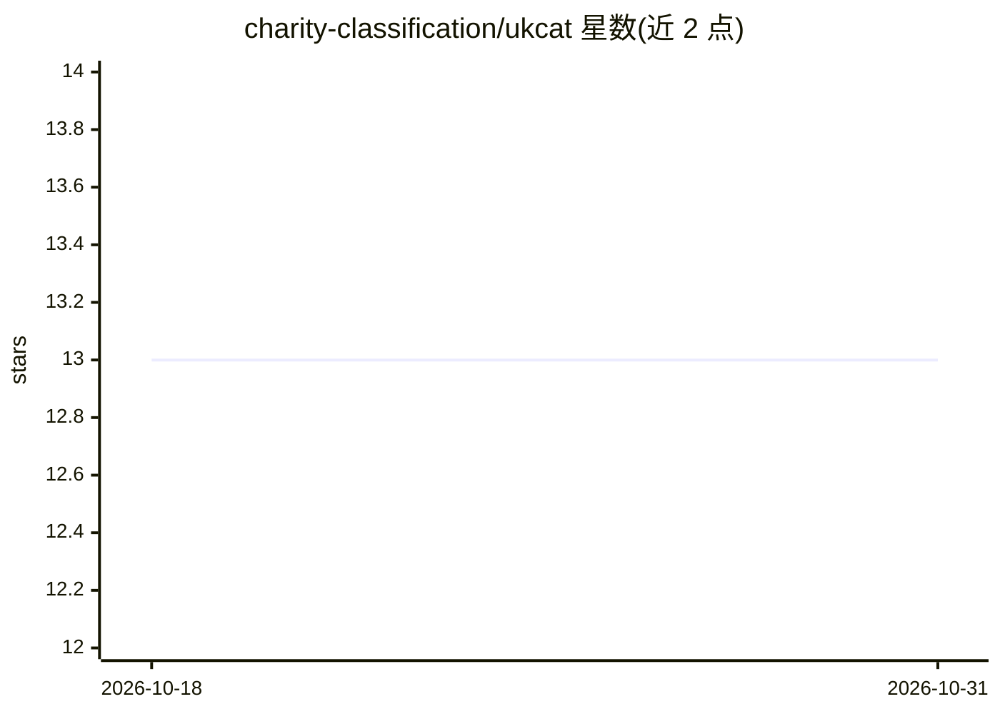

# charity-classification/ukcat

⭐ 13 · Jupyter Notebook · CC-BY-4.0 · 推送 2026-10-22 · [GitHub](https://github.com/charity-classification/ukcat) · [官网](https://www.charityclassification.org.uk/) · 组织维护

**对全英国注册慈善组织做分类打标的数据与工具集**

UK Charity Activity Tags 项目仓库：使用 UK-CAT 与 ICNP/TSO 两套分类体系，对英国所有注册慈善组织与社区利益公司（CIC）分类。UK-CAT 采用基于正则表达式的规则分类，ICNP/TSO 采用逻辑回归机器学习模型（人工标注可覆盖模型结果）。提供分类 schema、人工标注样本、全量分类结果 CSV 数据，以及一个 Python 模块（fetch/train/apply 命令）用于抓取慈善组织数据、训练模型并打标。由 NCVO Research、谢菲尔德哈勒姆大学研究者与独立研究者合作完成，数据以 CC BY 4.0 授权。

## 筛选速览

| 维度 | 判定 | 备注 |
|---|---|---|
| AI 角色 | `ai-native` | 本体是模型或模型工具 |
| 许可风险 | `viral` | CC-BY-4.0 |
| 部署形态 | `library` | 以包/库形式分发 |
| 模型依赖 | — | README 未给出锁定关系 |
| 硬件要求 | — | 无带数字的原话,不猜 |
| 安装摩擦 | `low` | 无编译、无系统依赖或容器化 |
| 成熟度 | — | 结构信号不足 |

## 能力要点

- 两套分类体系：UK-CAT（正则规则）与 ICNP/TSO（逻辑回归 ML 模型）
- 覆盖英国全部活跃/非活跃慈善组织与 CIC 的分类结果数据集
- python -m ukcat 提供 fetch/train/apply 命令行工作流
- 模型输出最佳类别及正确性估计概率，人工标注优先于模型

## 适用场景

- 研究英国慈善部门的活动分类与统计分析
- 为自己的慈善组织数据集应用 UK-CAT 或 ICNP/TSO 标签
- 复用人工标注样本训练或改进分类模型

## 场景标签

 · 领域:社会科学/第三部门研究

## 证据(README 行号)

> L3: This repository is the home of the *UK Charity Activity Tags*, a project to classify
> L70: The UK-CAT classification used a system of rules-based classification as described in the methodology. The ICNP/TSO
> L135: This script creates a Logistic Regression model for the ICNP/TSO categories, using the data found in

## 星数曲线

2026-10-18 13 → 2026-10-31 13（+0）

---
*卡片 v1 · prompt 1.4 · 生成 2026-10-31 · 置信度 mid · 依据 README sha `e5fb63284fba` · [字段定义](../../DATASET.md)*
