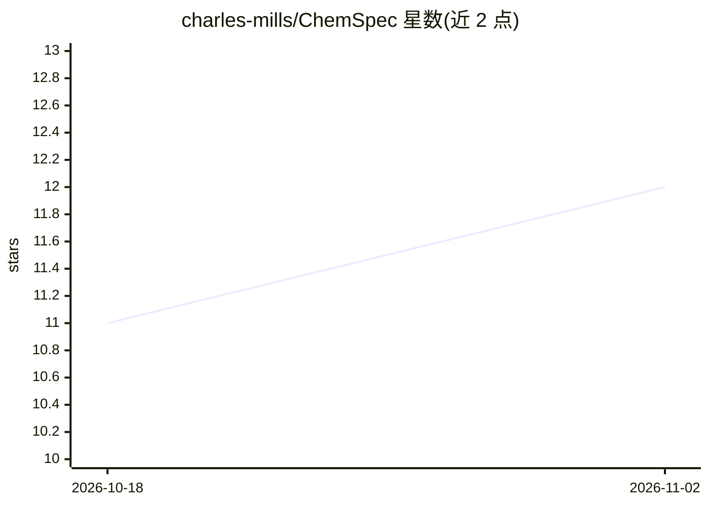

# charles-mills/ChemSpec

⭐ 12 · Rust · MIT · 推送 2026-08-28 · [GitHub](https://github.com/charles-mills/ChemSpec) · [官网](https://charles-mills.github.io/ChemSpec/) · 个人维护

**面向师生的化学反应模拟应用，可逐原子观察结构变化**

为 OpenAI Build Week 2026 教育类赛道构建的化学探索应用：学习者构造反应问题，逐原子追踪结构变化，并查看 3D 结果展示。提供 Web 浏览器演示（需 WebGPU 支持）、桌面版安装包与 Rust 源码运行三种方式。本地化学功能无需账号与网络；LLM 路径需额外安装 Codex CLI 并以 ChatGPT 账号登录。

## 筛选速览

| 维度 | 判定 | 备注 |
|---|---|---|
| AI 角色 | `ai-enhanced` | 去掉 AI 部分产品仍成立 |
| 许可风险 | `permissive` | MIT |
| 部署形态 | `None` |  |
| 模型依赖 | — | README 未给出锁定关系 |
| 硬件要求 | — | 无带数字的原话,不猜 |
| 安装摩擦 | `low` | 无编译、无系统依赖或容器化 |
| 成熟度 | `idea` | |

## 能力要点

- 构造反应问题并逐原子追踪结构变化
- 3D 结果展示
- 本地化学功能无需账号与网络连接
- 提供 Web 演示、桌面版与源码三种运行方式

## 适用场景

- 学生学习化学反应的结构变化过程
- 教师演示反应的逐原子演变
- 离线环境下使用本地化学模拟功能

## 场景标签

 · 领域:教育/化学模拟

## 证据(README 行号)

> L3: ChemSpec is a chemistry exploration app built for the Education category of OpenAI Build Week 2026. Learners constru
> L27: Local chemistry does not require an account or network connection. To use the LLM path, install the Codex CLI, sign

## 星数曲线

2026-10-18 11 → 2026-11-02 12（+1）

---
*卡片 v1 · prompt 1.4 · 生成 2026-11-02 · 置信度 mid · 依据 README sha `774879777a71` · [字段定义](../../DATASET.md)*
