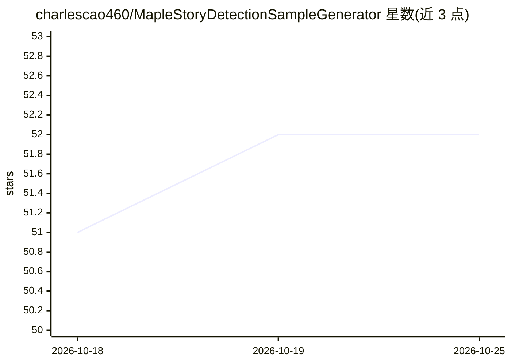

# charlescao460/MapleStoryDetectionSampleGenerator

⭐ 52 · C# · MIT · 推送 2026-06-26 · [GitHub](https://github.com/charlescao460/MapleStoryDetectionSampleGenerator) · 个人维护

**为冒险岛生成目标检测训练样本的工具（COCO/TFRecord/Darknet）**

基于 .NET 10 与 WzComparerR2 地图渲染器的样本生成器：从冒险岛地图渲染截图中生成任意数量的目标检测样本，边界框基于渲染坐标精确标注。支持普通角色/物体模式与符文关键点模式，可配置合成玩家外观、并发渲染、随机地图抽样；输出 COCO、TensorFlow TFRecord 与 Darknet 三种格式。需要 .NET 10 SDK 从源码构建，先运行 WzComparerR2 生成 Setting.config，再以 YAML 配置驱动 dotnet run 生成数据。README 记载配合 RTMDet 与约 10000 样本在测试集达到 97.3% mAP。

## 筛选速览

| 维度 | 判定 | 备注 |
|---|---|---|
| AI 角色 | `ai-ecosystem` | LLM/agent 周边工具 |
| 许可风险 | `permissive` | MIT |
| 部署形态 | `desktop` | 安装包/桌面程序 |
| 模型依赖 | — | README 未给出锁定关系 |
| 硬件要求 | — | 无带数字的原话,不猜 |
| 安装摩擦 | `medium` | 含编译或系统依赖之一 |
| 成熟度 | — | 结构信号不足 |

## 能力要点

- 基于渲染坐标的精确边界框自动标注，可生成任意数量样本
- 输出 COCO、TFRecord、Darknet 三种格式
- 符文模式输出 COCO 关键点标注（每图四箭头）
- 支持随机地图抽样与实时渲染合成玩家

## 适用场景

- 为冒险岛目标检测模型生成训练数据集
- 批量合成带精确标注的截图样本避免手工标注
- 生成符文箭头关键点检测数据

## 场景标签

 · 领域:计算机视觉/数据集生成

## 证据(README 行号)

> L2: Generate Machine Learning Samples Object Detection In MapleStory
> L7: With RTMDet and ~10000 samples, it can achieve 97.3%mAP in test set.

## 星数曲线

2026-10-18 51 → 2026-10-25 52（+1）

---
*卡片 v1 · prompt 1.4 · 生成 2026-10-24 · 置信度 high · 依据 README sha `12e4e0e638ec` · [字段定义](../../DATASET.md)*
