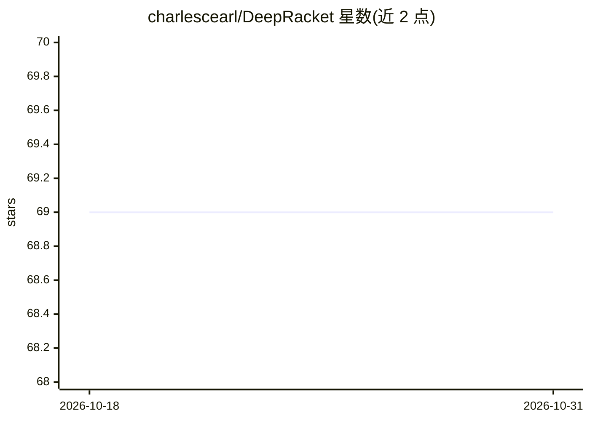

# charlescearl/DeepRacket

⭐ 69 · Racket · MIT · 推送 2026-03-28 · [GitHub](https://github.com/charlescearl/DeepRacket) · 个人维护

**Racket 语言深度学习接口库（封装 DyNet 与 cuDNN）**

为 Racket（Scheme/Lisp 方言）提供深度学习接口的库，分两部分：一是对 DyNet 神经网络库的初步封装，支持动态方式定义神经网络并附少量示例；二是对 NVIDIA cuDNN 底层库的接口，可创建 cuDNN 对象（如 RNN）并执行简单前向计算，损失计算与权重更新尚未实现。实现方式参考 Torch 深度学习库的封装。README 自述项目处于成长初期阶段。

## 筛选速览

| 维度 | 判定 | 备注 |
|---|---|---|
| AI 角色 | `ai-ecosystem` | LLM/agent 周边工具 |
| 许可风险 | `permissive` | MIT |
| 部署形态 | `None` |  |
| 模型依赖 | — | README 未给出锁定关系 |
| 硬件要求 | — | 无带数字的原话,不猜 |
| 安装摩擦 | `low` | 无编译、无系统依赖或容器化 |
| 成熟度 | `idea` | |

## 能力要点

- DyNet 封装支持动态定义神经网络，附简单示例
- cuDNN 底层接口可创建 RNN 等对象并执行前向计算
- 实现参考 Torch 深度学习库的封装结构

## 适用场景

- 在 Racket 中调用 DyNet 构建神经网络模型
- 需要底层 cuDNN 灵活性时以 Racket 编写前向计算
- 探索 Lisp 方言下的深度学习接口设计

## 场景标签

`推理引擎` · 领域:训练与推理

## 证据(README 行号)

> L3: This package provides a set of interfaces for doing deep learning in the Racket (a Scheme/Lisp dialect) programming 
> L7: The code here is split into two parts. The first and most useful for now is a very preliminary interface to the Dyne

## 星数曲线

2026-10-18 69 → 2026-10-31 69（+0）

---
*卡片 v1 · prompt 1.4 · 生成 2026-10-24 · 置信度 high · 依据 README sha `4e9b4b57fa1e` · [字段定义](../../DATASET.md)*
