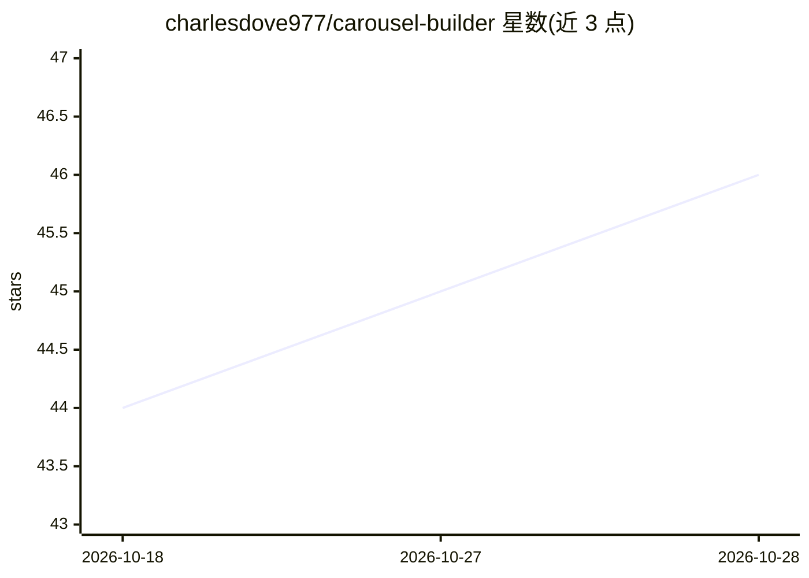

# charlesdove977/carousel-builder

⭐ 47 · MIT · 推送 2026-10-23 · [GitHub](https://github.com/charlesdove977/carousel-builder) · 个人维护

**在 Claude Code 内端到端生成品牌化 Instagram 轮播图文的命令插件**

面向使用 Claude Code 的内容创作者的命令包：`/carousel` 以访谈式、审批制流水线将一个主题转成成品轮播——读取参考模板、拆分 4-6 个支柱、经 Higgsfield MCP（nano_banana_2 模型）生成主题锁定的封面与配图、按字符预算起草文案、经 Canva MCP 复制模板并原位替换文本与图片，最后调用捆绑的 `/short-form-caption` 生成字幕。需自备两个 MCP 服务与 8 页 Canva 模板；Higgsfield 未连接时命令停止，不静默切换生成器。

## 筛选速览

| 维度 | 判定 | 备注 |
|---|---|---|
| AI 角色 | `ai-native` | 本体是模型或模型工具 |
| 许可风险 | `permissive` | MIT |
| 部署形态 | `None` |  |
| 模型依赖 | — | README 未给出锁定关系 |
| 硬件要求 | — | 无带数字的原话,不猜 |
| 安装摩擦 | `low` | 无编译、无系统依赖或容器化 |
| 成熟度 | — | 结构信号不足 |

## 能力要点

- 访谈式、审批制的轮播生成流水线（草稿→配图→Canva 组装→字幕）
- 字符预算在进入 Canva 前强制校验，防止文本溢出排版
- Higgsfield 生成封面与主题锁定支柱图（4:5 / 16:9）
- 捆绑 `/short-form-caption` 独立生成 500 字符内、5 标签的 IG/TikTok 字幕

## 适用场景

- 在自己的 Canva 模板上批量产出品牌统一的 Instagram 轮播
- 从视频转写或主题直接生成带 CTA 的短视频文案
- 不改模板前提下保证整副轮播视觉一致

## 场景标签

`AI 写作` `图像生成` · 领域:内容生成

## 证据(README 行号)

> L15: `/carousel` runs an interview-first, approval-gated pipeline that turns one topic into a finished, on-brand carouse
> L37: |**Higgsfield MCP**|Image + video generation (cover + pillar images). Uses the `nano_banana_2` model.|**Get Higgsfi
> L38: |**Canva MCP**|Duplicates your template and edits text + image fills in place.|Add `https://mcp.canva.com/mcp` as a

## 星数曲线

2026-10-18 44 → 2026-10-28 46（+2）

---
*卡片 v1 · prompt 1.4 · 生成 2026-10-25 · 置信度 high · 依据 README sha `189c9963edf9` · [字段定义](../../DATASET.md)*
