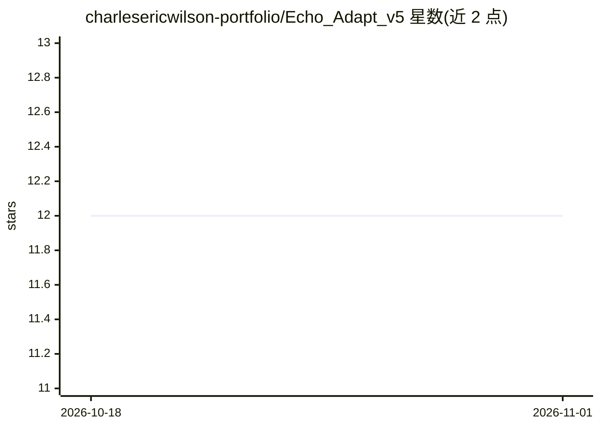

# charlesericwilson-portfolio/Echo_Adapt_v5

⭐ 12 · Rust · MIT · 推送 2026-10-13 · [GitHub](https://github.com/charlesericwilson-portfolio/Echo_Adapt_v5) · 个人维护

**Rust 编写的本地优先 LLM agent 运行时，提供工具执行与持久会话**

Adapt 是用 Rust 实现的 agent 执行运行时：让语言模型通过小型 XML 工具协议（一次性命令、tmux 持久会话、JSON 工具、<wait/>、<cleanup/>）操作真实操作系统工具。运行时负责执行状态管理、前台转后台交接、后台结果重注入、语义记忆（Markdown 存储 + embedding 检索）、SQLite/JSONL 日志、可选远程工具服务器（含 MCP 互操作）以及可选 Bubblewrap 隔离。兼容 OpenAI 类后端，作者主要配合自训模型 Echo Instroder 14B 使用；主平台为 Linux，Windows 需经 WSL2，原生 Windows 不支持，每模型回合仅执行一个工具动作。

## 筛选速览

| 维度 | 判定 | 备注 |
|---|---|---|
| AI 角色 | `ai-ecosystem` | LLM/agent 周边工具 |
| 许可风险 | `permissive` | MIT |
| 部署形态 | `None` |  |
| 模型依赖 | — | README 未给出锁定关系 |
| 硬件要求 | — | 无带数字的原话,不猜 |
| 安装摩擦 | `medium` | 含编译或系统依赖之一 |
| 成熟度 | `idea` | |

## 能力要点

- tmux 命名会话承载持久终端状态（REPL、调试器、SSH 等）
- 前台执行窗口 + 后台监督 + <wait/> 显式等待与空闲唤醒
- 两层摘要/上下文压缩与基于 embedding 的跨线程记忆
- 可选 Rust 工具服务器与 MCP 互操作、服务端能力强制

## 适用场景

- 让本地 LLM 在受控 Linux 环境中执行 shell 命令与结构化工具
- 需要持久终端会话（Python REPL、调试器、SSH）的多步工作流
- 长命令转后台执行并在完成后自动恢复 agent 循环

## 场景标签

`Agent 框架` `Agent 记忆` · 领域:Agent 开发

## 证据(README 行号)

> L11: Adapt gives language models a controlled way to use real operating-system tools over multi-step workflows.
> L42: Adapt handles execution, state, tool boundaries, persistent sessions, background work, memory, logging, provider ro
> L143: The main agent loop should not need to know whether the model is local, remote, OpenAI-compatible, or accessed thr

## 星数曲线

2026-10-18 12 → 2026-11-01 12（+0）

---
*卡片 v1 · prompt 1.4 · 生成 2026-11-01 · 置信度 high · 依据 README sha `55eb5821ebe0` · [字段定义](../../DATASET.md)*
