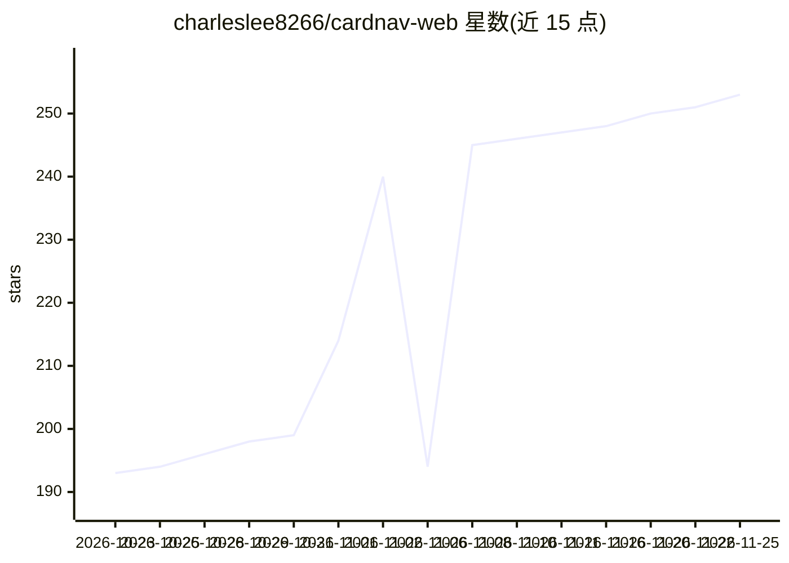

# charleslee8266/cardnav-web

⭐ 253 · TypeScript · AGPL-3.0 · 推送 2026-10-29 · [GitHub](https://github.com/charleslee8266/cardnav-web) · [官网](https://cardnav.xyz/) · 个人维护 · 中文 README

**AI 大模型账号购买导航站：聚合卡网、中转站与订阅比价**

一个公开网站项目，聚合 AI 账号、官方订阅、API 中转站与卡网商家信息，提供模型排行榜、订阅多地区价格对比（含人民币折算）、商家搜索筛选（关键词/价格区间/库存状态）与工具集（Session 转换、IP 纯净度检测、Outlook 取件）。内容层提供按“选模型→选使用方式→网络支付准备→日常风控”顺序组织的系统使用指南。源码以 npm 本地运行，需 PostgreSQL 数据库，支持商家提交与赞助位，代码采用 AGPL-3.0 许可。

## 筛选速览

| 维度 | 判定 | 备注 |
|---|---|---|
| AI 角色 | `ai-knowledge` | 知识聚合/清单类 |
| 许可风险 | `viral` | AGPL-3.0 |
| 部署形态 | `library` | 以包/库形式分发 |
| 模型依赖 | — | README 未给出锁定关系 |
| 硬件要求 | — | 无带数字的原话,不猜 |
| 安装摩擦 | `low` | 无编译、无系统依赖或容器化 |
| 成熟度 | — | 结构信号不足 |

## 能力要点

- 聚合卡网商家信息，支持关键词搜索、价格区间、库存状态与排序筛选
- ChatGPT/Claude/Gemini/Grok 等订阅在不同地区的价格与人民币折算对比
- 覆盖模型选择、购买方式、网络、支付、KYC 与风控的系统使用指南
- 提供 ChatGPT Session 转换、IP 纯净度检测等辅助工具集

## 适用场景

- 比较各官方订阅在不同地区的价格再决定购买方案
- 搜索并筛选第三方卡网商家的商品、库存与价格
- 下单前按指南补齐网络、支付、交付与风控准备

## 场景标签

 · 领域:AI 资源导航/信息聚合

## 证据(README 行号)

> L31: 卡网大全汇集 AI 账号、官方订阅、中转站与卡网商家信息，提供模型排行、使用指南和实用工具，帮助用户选型、比价和判断购买渠道。
> L39: |指南|把模型选择、使用方式、实操准备、商家判断、网络环境、支付方式、KYC 和日常风控串成一条完整路径，帮助用户在真正下单前先把关键判断补齐|
> L68: 指南 是卡网大全给新手用户准备的使用路径。它不是零散教程集合，而是按“先选模型、再选使用方式、再补齐网络与支付准备、最后处理日常风控”的顺序，系统性的把容易混在一起的问题拆开讲清楚。

## 星数曲线

2026-10-23 193 → 2026-11-25 253（+60）

---
*卡片 v1 · prompt 1.4 · 生成 2026-11-25 · 置信度 high · 依据 README sha `3b778419c860` · [字段定义](../../DATASET.md)*
