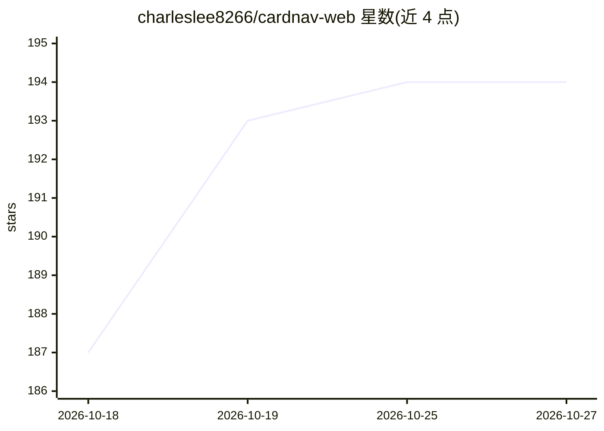

# charleslee8266/cardnav-web

⭐ 194 · TypeScript · AGPL-3.0 · 推送 2026-10-26 · [GitHub](https://github.com/charleslee8266/cardnav-web) · [官网](https://cardnav.xyz/) · 个人维护 · 中文 README

**AI 大模型账号购买导航站：聚合卡网商家、订阅比价与指南**

卡网大全（CardNav）是一个公开网站及其源码仓库：聚合第三方 AI 卡网商家与商品信息，支持关键词搜索、价格区间、库存状态筛选；提供按任务分类的模型排行榜、ChatGPT/Claude/Gemini 等官方订阅的地区比价与人民币折算、系统化使用指南（模型选择、订阅方式、网络、支付、KYC 风控）及 Session 转换、IP 纯净度检测等工具，另含商家提交与赞助收录机制。面向准备购买 AI 大模型账号或订阅的个人用户。技术栈为 Node/npm，需配置 Postgres 数据库与多个环境变量，采用 AGPLv3 许可证开源。

## 筛选速览

| 维度 | 判定 | 备注 |
|---|---|---|
| AI 角色 | `ai-knowledge` | 知识聚合/清单类 |
| 许可风险 | `viral` | AGPL-3.0 |
| 部署形态 | `library` | 以包/库形式分发 |
| 模型依赖 | — | README 未给出锁定关系 |
| 硬件要求 | — | 无带数字的原话,不猜 |
| 安装摩擦 | `low` | 无编译、无系统依赖或容器化 |
| 成熟度 | — | 结构信号不足 |

## 能力要点

- 聚合卡网商家与商品信息，支持关键词、价格区间、库存状态搜索
- 官方订阅多地区比价与人民币折算
- 覆盖模型选择、订阅方式、网络支付、KYC 风控的系统化指南
- 提供 ChatGPT Session 转换、IP 纯净度检测等辅助工具

## 适用场景

- 比较 ChatGPT、Claude、Gemini 等订阅在不同地区的价格
- 查找 AI 账号、卡密等第三方购买入口并筛选商家
- 购买前了解网络环境、支付方式与风控注意事项

## 场景标签

`精选清单` · 领域:学习与行业

## 证据(README 行号)

> L7:  一站式 AI 大模型账号购买导航。聚合 AI 中转站、卡网、官方订阅比价，还有模型排行、使用指南、实用工具，帮你少踩坑，少花钱。
> L31: 卡网大全把 AI 大模型账号、官方订阅、中转站、卡网商家、模型排行、使用指南和实用工具放在同一个公开入口里，帮助用户更快完成选型、比价、搜索和购买前判断。
> L40: |卡网商家|聚合第三方 AI 卡网商家与商品信息，支持关键词搜索、热门搜索、价格区间、库存状态、商家分组、综合排序和收藏，帮助用户更快筛出值得继续看的购买入口|

## 星数曲线

2026-10-18 187 → 2026-10-27 194（+7）

---
*卡片 v1 · prompt 1.4 · 生成 2026-10-22 · 置信度 high · 依据 README sha `3351562912f8` · [字段定义](../../DATASET.md)*
