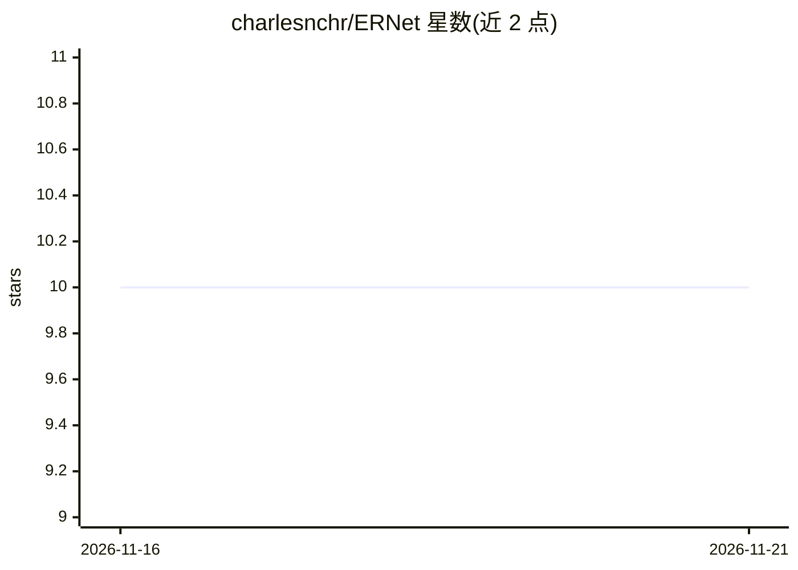

# charlesnchr/ERNet

⭐ 10 · Jupyter Notebook · GPL-3.0 · 推送 2026-11-15 · [GitHub](https://github.com/charlesnchr/ERNet) · [官网](https://www.science.org/doi/10.1126/sciadv.abc7209) · 个人维护

**活细胞显微图像内质网分割与管状网络图量化工具**

基于 PyTorch 的 CNN 分割工具：网络不做下采样，将宽场显微图像中的内质网小管与背景逐像素分类，SIM 图像则区分片层与小管；随后将小管细化为骨架，统计端点、三叉连接点、片段数、骨架长度等指标写入 metrics.csv。附预训练权重、五张人工标注的训练数据与训练脚本。CPU 可运行（1392x1040 单帧约 75 秒），有 GPU 时自动使用；模型权重随仓库下载，克隆约 140 MB。

## 筛选速览

| 维度 | 判定 | 备注 |
|---|---|---|
| AI 角色 | `ai-native` | 本体是模型或模型工具 |
| 许可风险 | `viral` | GPL-3.0 |
| 部署形态 | `library` | 以包/库形式分发 |
| 模型依赖 | — | README 未给出锁定关系 |
| 硬件要求 | — | 无带数字的原话,不猜 |
| 安装摩擦 | `low` | 无编译、无系统依赖或容器化 |
| 成熟度 | — | 结构信号不足 |

## 能力要点

- 全程不降采样的全分辨率分割架构（RCAN 改造，3.9M 参数）
- 分割结果转为 NetworkX 图并输出 tips/junctions/fragments 等量化指标
- 提供小管与 SIM 片层两个预训练模型，权重随仓库分发
- 多帧 TIFF 按时间序列逐帧输出，支持用自标数据重训

## 适用场景

- 对宽场荧光显微图像中的内质网做逐像素分割
- 量化细胞内小管网络随时间的拓扑变化
- 在仅有 CPU 的机器上批量处理显微图像序列
- 用少量标注图像训练自己的分割模型

## 场景标签

`目标检测` · 领域:感知与多模态

## 证据(README 行号)

> L18: ERNet starts from a network that was never meant for segmentation. RCAN was designed for single-image super-resolut
> L25: - **From pixels to a graph.** `segment.py` thins the tubules to a skeleton and counts tips, three-way junctions, tu
> L35: python segment.py testdata/input/*.png

## 星数曲线

2026-11-16 10 → 2026-11-21 10（+0）

---
*卡片 v1 · prompt 1.4 · 生成 2026-11-19 · 置信度 high · 依据 README sha `649bd07dded6` · [字段定义](../../DATASET.md)*
