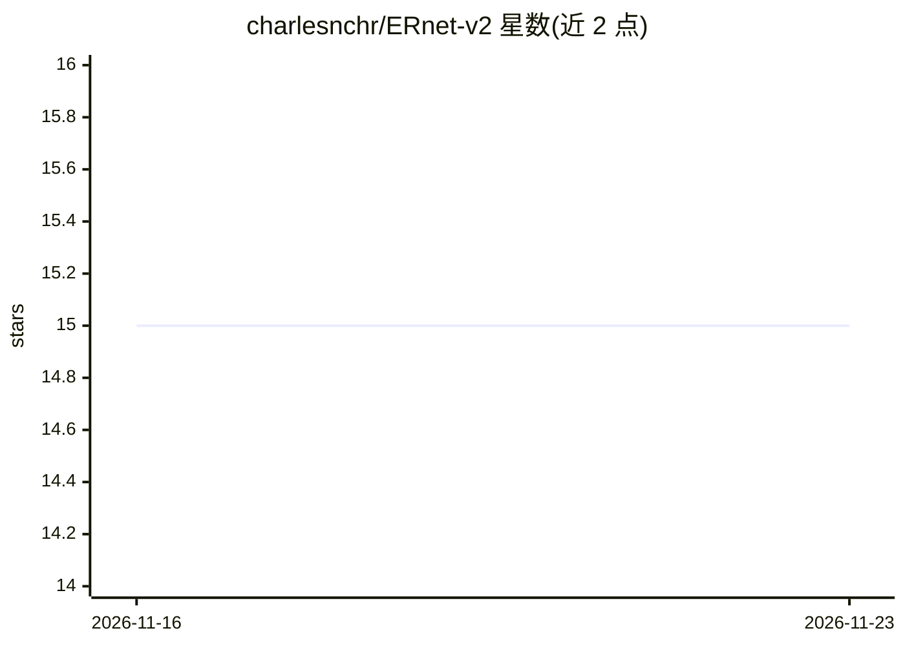

# charlesnchr/ERnet-v2

⭐ 15 · Python · GPL-3.0 · 推送 2026-11-15 · [GitHub](https://github.com/charlesnchr/ERnet-v2) · [官网](https://www.nature.com/articles/s41592-023-01815-0) · 组织维护

**内质网显微图像的分割与拓扑量化工具（vision transformer）**

面向细胞生物学研究者：用基于 Swin Transformer 的网络（0.59M 参数）将内质网荧光显微图像逐像素分为背景/小管/片层/片上小管四类，再把小管骨架转为图（sknw），用 NetworkX 输出节点数、度分布、同配性、聚类系数、碎片数等拓扑指标到 CSV。提供预训练权重、segment.py CLI 与 Colab 笔记本；CPU 可跑（1024px 约 40s/帧），训练代码需 CUDA 且未再维护；发布权重仅支持单帧模型，图仅覆盖小管类。

## 筛选速览

| 维度 | 判定 | 备注 |
|---|---|---|
| AI 角色 | `ai-native` | 本体是模型或模型工具 |
| 许可风险 | `viral` | GPL-3.0 |
| 部署形态 | `library` | 以包/库形式分发 |
| 模型依赖 | — | README 未给出锁定关系 |
| 硬件要求 | — | 无带数字的原话,不猜 |
| 安装摩擦 | `medium` | 含编译或系统依赖之一 |
| 成熟度 | `idea` | |

## 能力要点

- 四类逐像素分割（背景/小管/片层/片上小管）
- 小管骨架转图并输出节点/边/度分布/同配性/碎片数等拓扑指标
- 0.59M 参数、7MB 权重，四核 CPU 约 40s 处理一帧 1024x1024
- 提供合成网络图提取的 ground truth 检验脚本（节点/边中位偏差约 3%）

## 适用场景

- 量化实验或病理条件下内质网网络拓扑变化
- 对 SIM/宽场/共聚焦/Airyscan 图像做小管与片层分割
- 复现论文图表或基于公开数据集训练/测试自己的模型

## 场景标签

`目标检测` · 领域:感知与多模态

## 证据(README 行号)

> L4:  A vision transformer labels every pixel as tubule, sheet or sheet-based tubule.
> L5:  The tubules become a graph, and the graph puts numbers on the shape of the ER.
> L92: **1. Segmentation.** The released network follows SwinIR. Between convolution layers at the input and the output si

## 星数曲线

2026-11-16 15 → 2026-11-23 15（+0）

---
*卡片 v1 · prompt 1.4 · 生成 2026-11-18 · 置信度 mid · 依据 README sha `0de4dc77eabe` · [字段定义](../../DATASET.md)*
