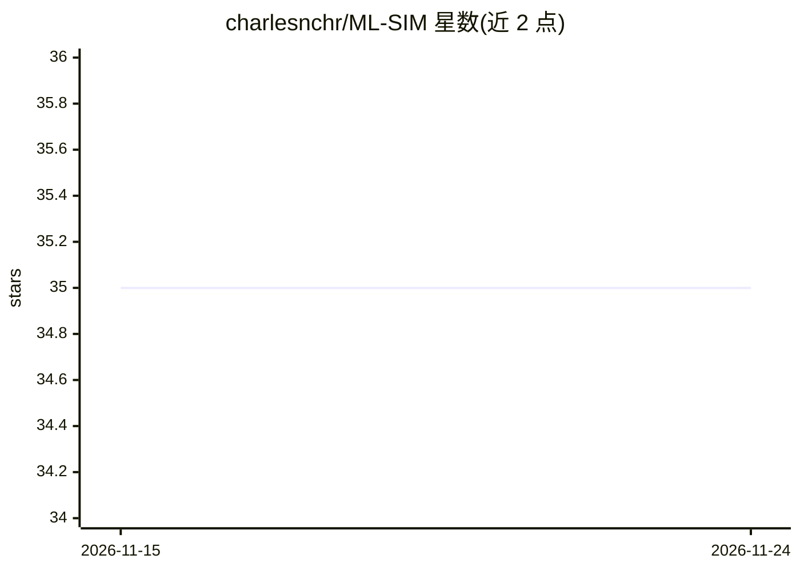

# charlesnchr/ML-SIM

⭐ 36 · Python · GPL-3.0 · 推送 2026-11-15 · [GitHub](https://github.com/charlesnchr/ML-SIM) · [官网](https://ml-sim.github.io) · 组织维护

**神经网络 SIM 超分辨显微重建：仅靠仿真数据训练**

面向结构光照明显微（SIM）的重建工具：用 RCAN 网络（5.4M 参数）一次前向将 9 帧原始 SIM 图像转为超分辨图像。训练数据不来自显微镜，而是 DIV2K 照片经 SIM 成像仿真生成，同一权重无需微调即可重建真实显微镜数据。附带 OpenSIM 仿真器的 Python 移植（NumPy/SciPy）、训练管线、桌面批量重建应用。GTX 1080 Ti 上单次重建低于 200 ms。限制：仅支持 2D SIM 九帧方案，3D SIM 不支持；仿真不模拟离焦光。以 GPL-3.0 发布。

## 筛选速览

| 维度 | 判定 | 备注 |
|---|---|---|
| AI 角色 | `ai-native` | 本体是模型或模型工具 |
| 许可风险 | `viral` | GPL-3.0 |
| 部署形态 | `library` | 以包/库形式分发 |
| 模型依赖 | — | README 未给出锁定关系 |
| 硬件要求 | — | 无带数字的原话,不猜 |
| 安装摩擦 | `medium` | 含编译或系统依赖之一 |
| 成熟度 | — | 结构信号不足 |

## 能力要点

- 9 帧输入一次前向输出超分辨图像，无参数可调
- 训练仅需仿真数据，DIV2K 照片经 SIM 成像仿真生成配对数据
- 附带 OpenSIM 成像模型的 Python 移植，可独立生成测试数据
- 提供预训练权重（64 MB）、Streamlit 仿真器与桌面批量重建应用

## 适用场景

- 对 3x3 相位的 SIM 原始数据快速重建超分辨图像
- 采集时实时预览重建结果
- 生成带真值的仿真 SIM 数据测试重建算法
- 针对自有显微镜参数重新生成数据并训练模型

## 场景标签

`图像视频处理` · 领域:感知与多模态

## 证据(README 行号)

> L3:  Super-resolution microscopy reconstruction, learned from simulation alone.
> L71: ML-SIM learns the inversion from examples. Every training example starts as an ordinary photograph, which serves as
> L152: ML-SIM was developed in the Laser Analytics Group and the Artificial Intelligence Group at the University of Cambr

## 星数曲线

2026-11-15 35 → 2026-11-24 35（+0）

---
*卡片 v1 · prompt 1.4 · 生成 2026-11-18 · 置信度 high · 依据 README sha `19086d491af2` · [字段定义](../../DATASET.md)*
