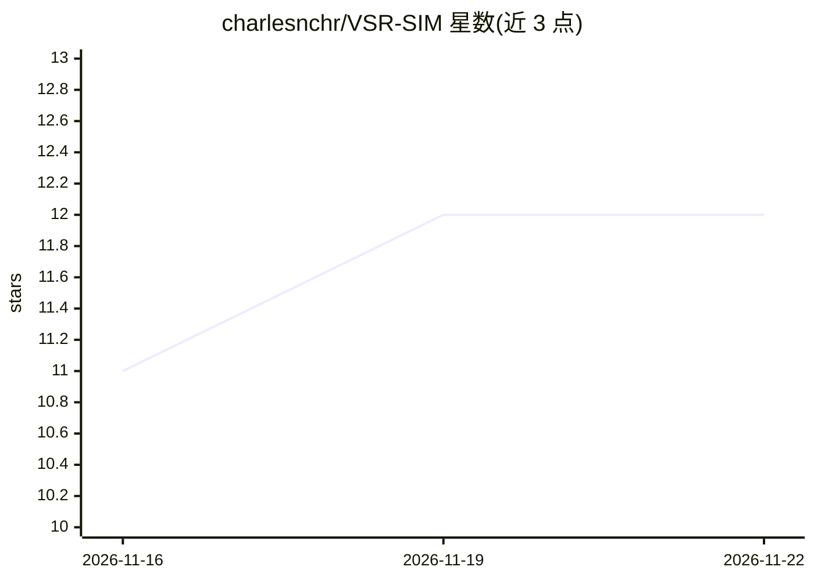

# charlesnchr/VSR-SIM

⭐ 12 · Python · GPL-3.0 · 推送 2026-11-15 · [GitHub](https://github.com/charlesnchr/VSR-SIM) · [官网](https://arxiv.org/abs/2203.00030) · 个人维护

**面向活细胞SIM显微成像者的运动鲁棒超分辨重建网络**

将九帧SIM曝光当作短视频处理的深度学习重建工具：带窗口自注意力与通道注意力的 transformer 一次读取九帧，重建中间帧的超分辨图像，支持逐帧滑动的 rolling 重建（N 原始帧产出 N-8 张图，而非每九帧一张）。仅用模拟数据训练（纪录片视频经显微成像模拟），无需光流。提供预训练权重、示例数据、推理与再训练脚本；GPU 可用时加速，CPU 上 512x512 一栈约一分钟。

## 筛选速览

| 维度 | 判定 | 备注 |
|---|---|---|
| AI 角色 | `ai-native` | 本体是模型或模型工具 |
| 许可风险 | `viral` | GPL-3.0 |
| 部署形态 | `library` | 以包/库形式分发 |
| 模型依赖 | — | README 未给出锁定关系 |
| 硬件要求 | — | 无带数字的原话,不猜 |
| 安装摩擦 | `medium` | 含编译或系统依赖之一 |
| 成熟度 | — | 结构信号不足 |

## 能力要点

- rolling 重建：帧率提升九倍，每帧产出一张超分辨图像
- 仅用模拟数据训练，可重建从未见过的真实 SIM 采集
- 基于 Swin transformer 窗口注意力，无光流与运动模型
- git clone 后三条命令完成权重下载与示例重建

## 适用场景

- 对运动中的活细胞 SIM 采集做超分辨重建
- 处理传统重建算法出现拖影/条纹伪影的运动样本数据
- 针对不同采集方案（波长/数值孔径）重新生成模拟数据并训练模型

## 场景标签

`图像视频处理` `模型训练` · 领域:感知与多模态

## 证据(README 行号)

> L4:  A video transformer that reconstructs structured illumination microscopy through motion,
> L17: VSR-SIM treats the nine exposures as a short video. A transformer with windowed self-attention and channel attentio
> L101: The network is a stack of window channel attention blocks. Each block runs Swin transformer layers, which compute 

## 星数曲线

2026-11-16 11 → 2026-11-22 12（+1）

---
*卡片 v1 · prompt 1.4 · 生成 2026-11-18 · 置信度 mid · 依据 README sha `5bb2888d6bfb` · [字段定义](../../DATASET.md)*
