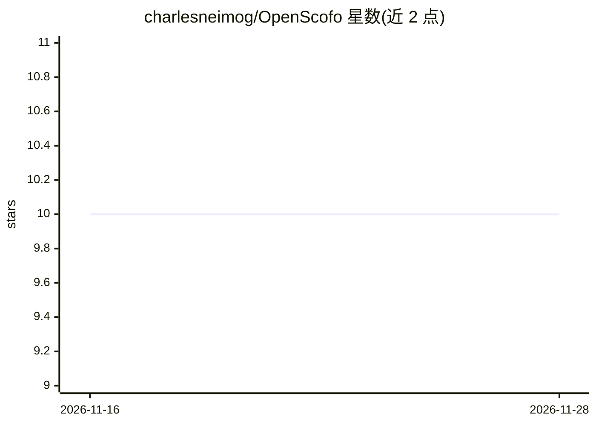

# charlesneimog/OpenScofo

⭐ 10 · C++ · GPL-3.0 · 推送 2026-11-24 · [GitHub](https://github.com/charlesneimog/OpenScofo) · [官网](https://charlesneimog.github.io/OpenScofo/) · 个人维护

**面向研究者与音乐人的实时乐谱跟随 C++ 库**

OpenScofo 是一个乐谱跟随库，为当代音乐应用提供实时演奏位置对齐能力；最初为 PureData 对象，现已扩展为 C++ 库并集成 Max、Python 等环境。技术上采用 KL 散度做音高比较、节奏同步理论与前向算法，并通过 ONNX 推理做实时扩展技法检测。支持 pip 安装预编译包或从源码用 CMake 构建，多个构建开关可选择性编译各宿主插件。

## 筛选速览

| 维度 | 判定 | 备注 |
|---|---|---|
| AI 角色 | `ai-native` | 本体是模型或模型工具 |
| 许可风险 | `viral` | GPL-3.0 |
| 部署形态 | `desktop` | 安装包/桌面程序 |
| 模型依赖 | — | README 未给出锁定关系 |
| 硬件要求 | — | 无带数字的原话,不猜 |
| 安装摩擦 | `medium` | 含编译或系统依赖之一 |
| 成熟度 | `idea` | |

## 能力要点

- 多宿主集成：PureData、Max/MSP、SuperCollider、CSound、Python、Vamp
- 基于 KL 散度音高比较与前向算法的实时乐谱跟随
- libonnx 实时扩展技法检测
- 配合 pd4web 可在浏览器中运行

## 适用场景

- 当代音乐排练中实时跟随演奏者的乐谱位置
- 为电子音乐作品实现乐谱驱动的实时触发
- 乐谱跟随算法的研究与复现

## 场景标签

`科研工具` · 领域:学习与行业

## 证据(README 行号)

> L4: `OpenScofo` is an open-source project designed to provide score following capabilities for contemporary music applic
> L34: * **libonnx**: A C library used to perform inference with ONNX models for real-time extended-technique detection.

## 星数曲线

2026-11-16 10 → 2026-11-28 10（+0）

---
*卡片 v1 · prompt 1.4 · 生成 2026-11-19 · 置信度 mid · 依据 README sha `67bf24ff1719` · [字段定义](../../DATASET.md)*
