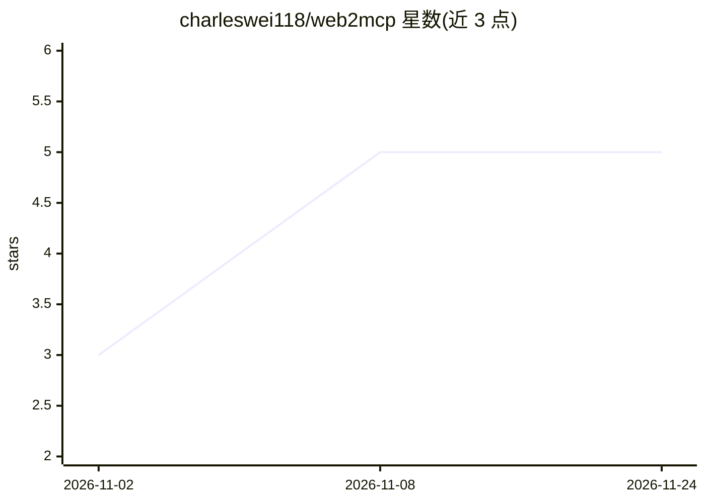

# charleswei118/web2mcp

⭐ 5 · JavaScript · MIT · 推送 2026-11-13 · [GitHub](https://github.com/charleswei118/web2mcp) · [官网](https://web2mcp.cwei59969.workers.dev) · 个人维护 · 中文 README

**开发者将任意网站/REST API 以配置方式转为 MCP 工具**

一个运行在 Cloudflare Workers 上的零运行时依赖网关：用约 15 行配置描述一个 HTTP API 即可将其转为类型化的 MCP 工具，供任意 MCP 客户端调用。提供 GitHub、Wikipedia、天气、汇率、arXiv 等十余个免密钥内置连接器，支持 OpenAPI 规格一键导入、catalog 模式将数百端点压缩为 2 个工具以节省上下文、pick/fields 裁剪响应、SSRF 防护与 bearer 认证。可一键部署到 Cloudflare、本地 stdio 运行或 Docker 构建；不支持浏览器自动化、登录抓取与代用户 OAuth。

## 筛选速览

| 维度 | 判定 | 备注 |
|---|---|---|
| AI 角色 | `ai-ecosystem` | LLM/agent 周边工具 |
| 许可风险 | `permissive` | MIT |
| 部署形态 | `self-host` | docker 或自建部署 |
| 模型依赖 | — | README 未给出锁定关系 |
| 硬件要求 | — | 无带数字的原话,不猜 |
| 安装摩擦 | `low` | 无编译、无系统依赖或容器化 |
| 成熟度 | — | 结构信号不足 |

## 能力要点

- 配置即连接器：描述 base URL/路径/参数即生成类型化 MCP 工具，无需 SDK
- catalog 模式将 665 个端点压缩为 search_api+call_api 两个工具（约 300 tokens）
- OpenAPI 3 规格可经脚本转为连接器；连接器可经 CONNECTORS_JSON 无代码注入
- 零运行时依赖（约 800 行 JavaScript），支持 Workers 部署、本地 stdio 与 Docker

## 适用场景

- 让 AI agent 直接调用某个公开 REST API 而不必手写 MCP 服务器
- 大型 API（数百端点）以 catalog 模式接入，避免工具定义占满上下文
- 无需云账号，本地 stdio 运行为自己的客户端提供工具

## 场景标签

 · 领域:LLM 基础设施/MCP 工具接入

## 证据(README 行号)

> L16: Every AI agent (Claude, ChatGPT, Cursor, your own bots…) now speaks the **Model Context Protocol**. But most websit
> L76: - **Config, not code.** A connector is a plain object: base URL, path, query, params. No SDK to learn.
> L220: ## Catalog mode: 665 endpoints, 2 tools

## 星数曲线

2026-11-02 3 → 2026-11-24 5（+2）

---
*卡片 v1 · prompt 1.4 · 生成 2026-11-21 · 置信度 high · 依据 README sha `d738b8f12913` · [字段定义](../../DATASET.md)*
