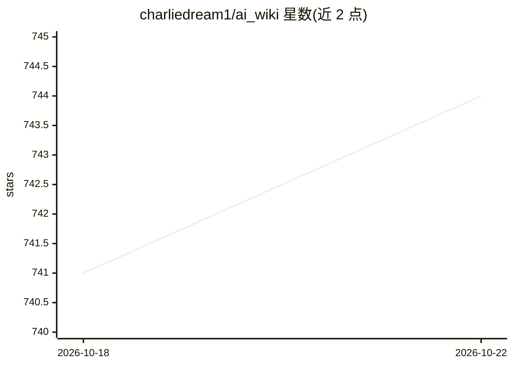

# charliedream1/ai_wiki

⭐ 745 · Jupyter Notebook · 推送 2026-10-10 · [GitHub](https://github.com/charliedream1/ai_wiki) · 个人维护 · 中文 README

**覆盖 AI 全栈的工程实践知识库与资源搜集站**

个人维护的中文 AI 知识库：以工程问题为背景，按编程基础、数据库存储、机器学习与深度学习理论、传统深度学习应用（图像/NLP/音频/时序/视频）、大模型应用（LLM、RAG、Agent、Prompt）、部署工具与职业成长等模块组织内容，收录解决策略、案例代码与资源汇总。使用方式为浏览 GitHub/Gitee 镜像上的文档，无安装运行步骤；另关联作者的量化交易项目，并提供知识星球付费社区与微信公众号等渠道。

## 筛选速览

| 维度 | 判定 | 备注 |
|---|---|---|
| AI 角色 | `ai-knowledge` | 知识聚合/清单类 |
| 许可风险 | `none` | — |
| 部署形态 | `None` |  |
| 模型依赖 | — | README 未给出锁定关系 |
| 硬件要求 | — | 无带数字的原话,不猜 |
| 安装摩擦 | `low` | 无编译、无系统依赖或容器化 |
| 成熟度 | — | 结构信号不足 |

## 能力要点

- 按十余个模块组织 AI 全栈知识，覆盖 LLM、RAG、Agent、多模态等主题
- 每个主题以工程问题为背景，提供解决策略与关键代码
- 提供 Gitee 国内镜像访问
- 包含知识点精要、思维导图与面试/职业成长内容

## 适用场景

- 按模块查找 AI 工程实践中具体问题的解决策略
- 系统学习从编程基础到大模型应用的全栈知识
- 追踪前沿技术发展与工具资源汇总

## 场景标签

`教程课程` `精选清单` · 领域:学习与行业

## 证据(README 行号)

> L3: ### 大模型避坑指南 · AI 全栈工程实践知识库
> L19: > 分享工程实践中的问题解决策略与关键要点，追踪前沿技术发展，覆盖 AI 全栈知识，帮助开发者高效掌握 AI 技术，提升应用能力。

## 星数曲线

2026-10-18 741 → 2026-10-22 744（+3）

---
*卡片 v1 · prompt 1.4 · 生成 2026-10-21 · 置信度 high · 依据 README sha `49fd15a1b44a` · [字段定义](../../DATASET.md)*
