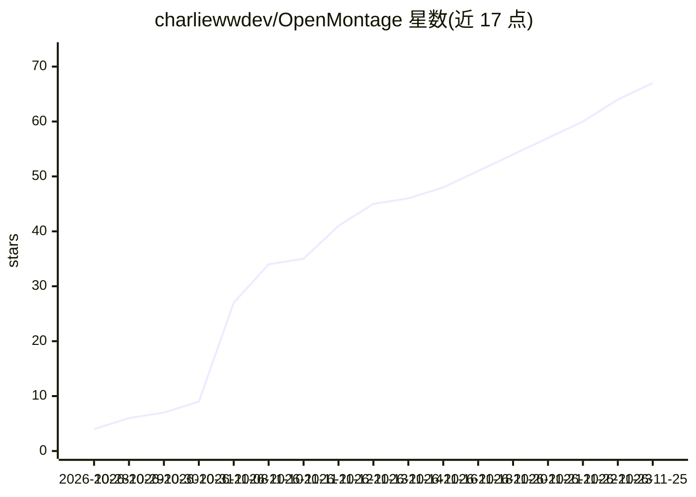

# charliewwdev/OpenMontage

⭐ 67 · Python · AGPL-3.0 · 推送 2026-11-19 · [GitHub](https://github.com/charliewwdev/OpenMontage) · [官网](https://openmontage.dtok.io) · 个人维护 · 中文 README

**自托管的 AI 短剧/短视频制作工作台：一句话创意到成片**

面向内容创作者的自托管 Web 工作台：输入一句话创意，经 7 阶段流水线（剧本→角色→场景→道具→分镜与镜头→配音→剪辑）产出短剧、爆款短视频或产品广告，每个阶段可编辑、可单独重跑。文本/图像/视频模型自带 API key（DeepSeek、OpenAI、Claude、Gemini、Qwen 等），图像视频默认走火山引擎 Seedream/Seedance（付费），配音默认 edge-tts，剪辑用 FFmpeg。以 Docker Compose 一键部署，内置 PostgreSQL/Redis/MinIO。

## 筛选速览

| 维度 | 判定 | 备注 |
|---|---|---|
| AI 角色 | `ai-native` | 本体是模型或模型工具 |
| 许可风险 | `viral` | AGPL-3.0 |
| 部署形态 | `self-host` | docker 或自建部署 |
| 模型依赖 | locked-api |  |
| 硬件要求 | — | 无带数字的原话,不猜 |
| 安装摩擦 | `low` | 无编译、无系统依赖或容器化 |
| 成熟度 | — | 结构信号不足 |

## 能力要点

- 7 阶段生产流水线，每阶段可编辑与重跑，支持 Agent 一键跑全程
- 自带 key 接入多家文本 LLM，图像视频支持 Seedream/Seedance 或自有 ComfyUI
- 爆款内容广场提供多平台结构化模板（抖音/TikTok/小红书等）
- Docker Compose 一键部署，内置 PostgreSQL/Redis/MinIO

## 适用场景

- 一句话创意生成短剧剧本并走完分镜、配音、剪辑到成片
- 制作抖音/TikTok/Reels 风格的爆款短视频或电商产品广告
- 在自有服务器上搭建可控的 AI 视频生产环境

## 场景标签

`视频生成` `语音合成` `图像生成` · 领域:内容生成

## 证据(README 行号)

> L48: OpenMontage Drama Studio is a web studio for making short-form video with AI. You describe an idea in one
> L53: - **Bring your own keys.** Text models, image models and video models are configured per account in *Model settings
> L69: |5|**Storyboard & shots** (分镜)|LLM shot breakdown; Seedance generates each shot using the character / scene / prop 

## 星数曲线

2026-10-28 4 → 2026-11-25 67（+63）

---
*卡片 v1 · prompt 1.4 · 生成 2026-11-18 · 置信度 high · 依据 README sha `48d6c1082253` · [字段定义](../../DATASET.md)*
