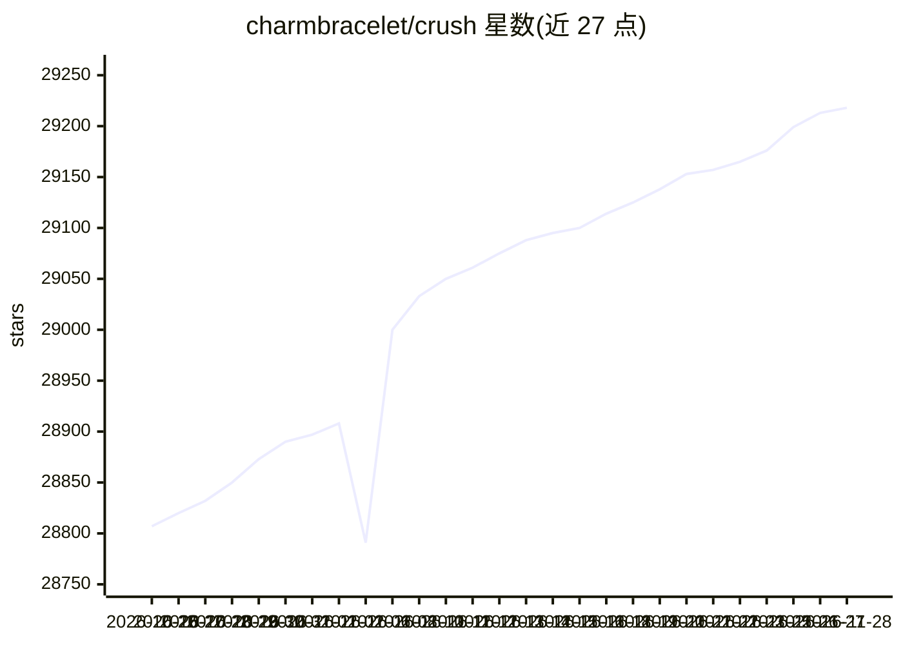

# charmbracelet/crush

⭐ 29,218 · Go · NOASSERTION · 推送 2026-11-27 · [GitHub](https://github.com/charmbracelet/crush) · 组织维护

**终端里的 agentic 编程客户端，接入任意 LLM 辅助写代码**

Charm 出品的终端编程 Agent 工具：在终端中以多会话方式接入用户选择的 LLM，配合本地工具、代码与工作流完成编码任务。支持通过 OpenAI/Anthropic 兼容 API 配置多模型并会话中切换且保留上下文，利用 LSP 提供额外上下文，通过 MCP（stdio/http/sse）扩展能力并接收实时事件。安装覆盖 Homebrew、Winget/Scoop、Nix NUR、apt/yum 仓库、二进制包与 go install，支持 macOS/Linux/Windows/FreeBSD 等平台。配置采用 Bash 风格的 crushrc，旧 JSON 配置仍支持但已标记废弃。

## 筛选速览

| 维度 | 判定 | 备注 |
|---|---|---|
| AI 角色 | `ai-ecosystem` | LLM/agent 周边工具 |
| 许可风险 | `none` | NOASSERTION |
| 部署形态 | `library` | 以包/库形式分发 |
| 模型依赖 | local-ok | 支持本地模型 |
| 硬件要求 | — | 无带数字的原话,不猜 |
| 安装摩擦 | `low` | 无编译、无系统依赖或容器化 |
| 成熟度 | — | 结构信号不足 |

## 动量与使用信号

- 维护:`active` — 距上次 push 0.7 天,年发版 100,156 位贡献者
- 涨星:近 1 天 **+14**(自 20261016 起算)
- 安装:npm 包 `@charmland/crush` 月下载 38,520
- 平台:WINDOWS / MACOS / LINUX / ANDROID · 协议:OPENAI-API / MCP / OLLAMA

## 能力要点

- 多模型接入：OpenAI- 或 Anthropic- 兼容 API，可自定义 Provider（含本地模型）
- 会话中切换 LLM 且保留上下文，每项目支持多会话
- LSP 增强上下文，MCP 三种传输方式扩展并支持 OAuth
- Bash 风格 crushrc 配置，内置配色主题系统

## 适用场景

- 在终端里让 LLM Agent 协助完成编码任务
- 同一项目维护多个会话并随时切换模型
- 通过 MCP 服务器接入 CI 事件、webhook 等外部信号

## 场景标签

`编码 Agent` · 领域:编码与开发

## 证据(README 行号)

> L7:  Your new coding bestie, now available in your favourite terminal. Your tools, your code, and your workflows, wired 
> L14: - **Multi-Model:** choose from a wide range of LLMs or add your own via OpenAI- or Anthropic-compatible APIs
> L334: Crush also supports Model Context Protocol (MCP) servers through three transport

## 星数曲线

2026-10-26 28,807 → 2026-11-28 29,218（+411）

---
*卡片 v1 · prompt 1.4 · 生成 2026-11-26 · 置信度 high · 依据 README sha `5cbbf15fb07c` · [字段定义](../../DATASET.md)*
