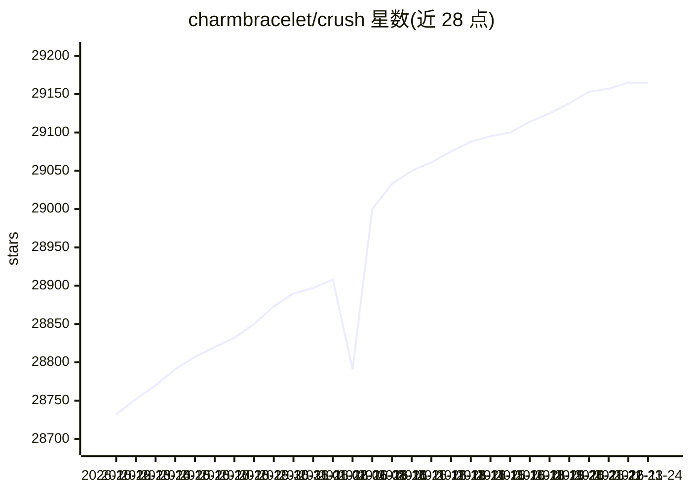

# charmbracelet/crush

⭐ 29,165 · Go · NOASSERTION · 推送 2026-11-22 · [GitHub](https://github.com/charmbracelet/crush) · 组织维护

**终端里的 AI 编程代理客户端，可接入多种 LLM**

Charm 出品的终端编程代理工具：用户在终端内以会话方式与所选 LLM 协作完成编码任务，支持多模型切换且保留上下文、按项目维护多个会话、借助 LSP 获取代码上下文、通过 MCP（http/stdio/sse）扩展能力并接收实时事件。配置采用 Bash 语法的 crushrc，可本地或全局配置；内置主题系统，支持 macOS、Linux、Windows、BSD 及 Android 等平台的各类终端运行。提供 Homebrew、winget、APT、NUR、Go install 等多种安装方式。

## 筛选速览

| 维度 | 判定 | 备注 |
|---|---|---|
| AI 角色 | `ai-ecosystem` | LLM/agent 周边工具 |
| 许可风险 | `none` | NOASSERTION |
| 部署形态 | `library` | 以包/库形式分发 |
| 模型依赖 | local-ok | 支持本地模型 |
| 硬件要求 | — | 无带数字的原话,不猜 |
| 安装摩擦 | `low` | 无编译、无系统依赖或容器化 |
| 成熟度 | — | 结构信号不足 |

## 动量与使用信号

- 维护:`active` — 距上次 push 0.7 天,年发版 100,156 位贡献者
- 涨星:近 1 天 **+14**(自 20261016 起算)
- 安装:npm 包 `@charmland/crush` 月下载 38,520
- 平台:WINDOWS / MACOS / LINUX / ANDROID · 协议:OPENAI-API / MCP / OLLAMA

## 能力要点

- 多模型接入：支持 OpenAI/Anthropic 兼容 API 与自定义 provider，会话中可切换模型并保留上下文
- 利用 LSP 提供额外代码上下文
- 支持三种传输方式的 MCP 服务器及 OAuth 授权流程
- Bash 语法配置（crushrc），跨平台一致，兼容 XDG 目录规范

## 适用场景

- 在终端中用多个会话管理不同项目的编码任务
- 通过自定义 provider 接入本地模型进行开发
- 用 MCP 服务器接入 CI、webhook 等外部事件源

## 场景标签

`编码 Agent` · 领域:编码与开发

## 证据(README 行号)

> L7:  Your new coding bestie, now available in your favourite terminal. Your tools, your code, and your workflows, wired 
> L14: - **Multi-Model:** choose from a wide range of LLMs or add your own via OpenAI- or Anthropic-compatible APIs
> L18: - **Extensible:** add capabilities via MCPs (`http`, `stdio`, and `sse`)

## 星数曲线

2026-10-22 28,732 → 2026-11-24 29,165（+433）

---
*卡片 v1 · prompt 1.4 · 生成 2026-11-22 · 置信度 high · 依据 README sha `c6053f4794b0` · [字段定义](../../DATASET.md)*
