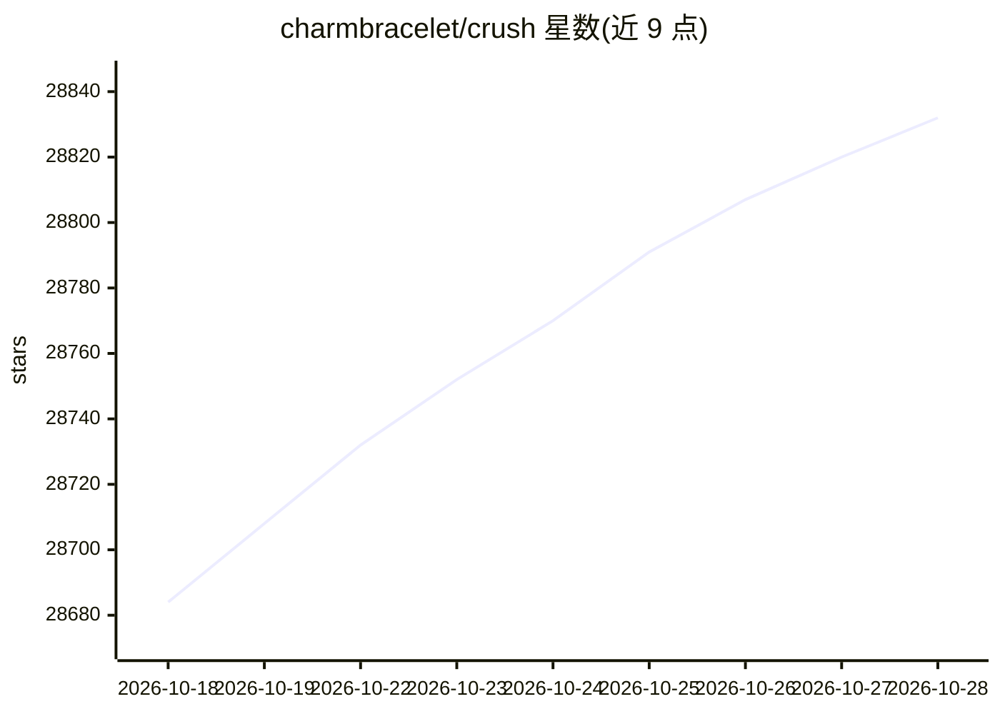

# charmbracelet/crush

⭐ 28,832 · Go · NOASSERTION · 推送 2026-10-27 · [GitHub](https://github.com/charmbracelet/crush) · 组织维护

**给开发者的终端 AI 编程 Agent，接入自选 LLM 进行代码工作**

一个运行在终端中的 agentic coding 工具（TUI），将用户的工具、代码与工作流接入所选 LLM。关键机制：支持通过 OpenAI 或 Anthropic 兼容 API 接入多种模型，会话中途切换 LLM 并保留上下文；每个项目可维护多个会话；利用 LSP 获取额外上下文；通过 MCP（stdio/http/sse）扩展能力。配置采用 Bash 风格的 crushrc，支持项目级与全局级；旧 JSON 配置仍支持但已标记废弃。提供 brew、winget、scoop、Nix、apt、yum、二进制包与 go install 等多种安装方式。

## 筛选速览

| 维度 | 判定 | 备注 |
|---|---|---|
| AI 角色 | `ai-native` | 本体是模型或模型工具 |
| 许可风险 | `none` | NOASSERTION |
| 部署形态 | `library` | 以包/库形式分发 |
| 模型依赖 | local-ok | 支持本地模型 |
| 硬件要求 | — | 无带数字的原话,不猜 |
| 安装摩擦 | `low` | 无编译、无系统依赖或容器化 |
| 成熟度 | — | 结构信号不足 |

## 动量与使用信号

- 维护:`active` — 距上次 push 0.7 天,年发版 100,156 位贡献者
- 涨星:近 1 天 **+14**(自 20261016 起算)
- 安装:npm 包 `@charmland/crush` 月下载 38,520
- 平台:WINDOWS / MACOS / LINUX / ANDROID · 协议:OPENAI-API / MCP / OLLAMA

## 能力要点

- 多模型接入：OpenAI/Anthropic 兼容 API，会话内切换模型保留上下文
- 利用 LSP 为决策提供额外代码上下文
- 支持 MCP 三种传输方式（stdio/http/sse）及 OAuth 授权
- crushrc（Bash 风格）配置，内置自配置技能，跨平台一致

## 适用场景

- 在终端中用自选 LLM 进行 agentic 编程
- 同一项目维护多个独立工作会话与上下文
- 通过 MCP 与 LSP 扩展 Agent 的工具与代码理解能力

## 场景标签

`编码 Agent` · 领域:编码与开发

## 证据(README 行号)

> L7:  Your new coding bestie, now available in your favourite terminal. Your tools, your code, and your workflows, wired 
> L14: - **Multi-Model:** choose from a wide range of LLMs or add your own via OpenAI- or Anthropic-compatible APIs
> L17: - **LSP-Enhanced:** Crush uses LSPs for additional context, just like you do

## 星数曲线

2026-10-18 28,684 → 2026-10-28 28,832（+148）

---
*卡片 v1 · prompt 1.4 · 生成 2026-10-18 · 置信度 high · 依据 README sha `9b69c06bc2bb` · [字段定义](../../DATASET.md)*
