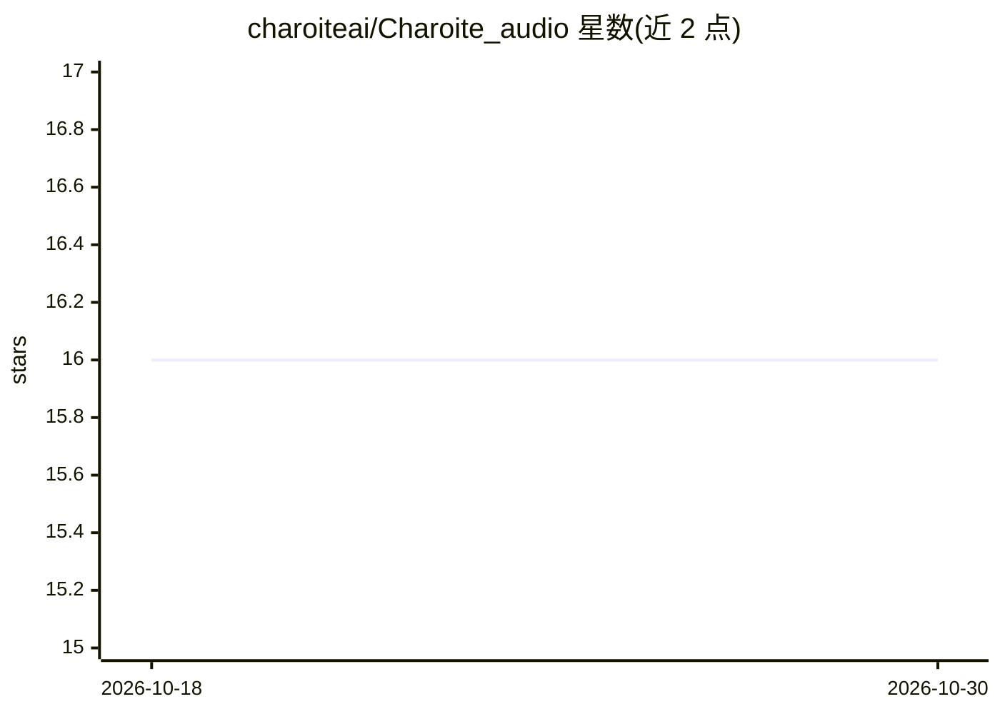

# charoiteai/Charoite_audio

⭐ 16 · Python · Apache-2.0 · 推送 2026-10-29 · [GitHub](https://github.com/charoiteai/Charoite_audio) · [官网](https://github.com/charoiteai/Charoite_audio/releases/latest) · 组织维护 · 中文 README

**macOS 全本地 AI 会议助手：转写+说话人分离+自更新知识图谱**

运行在 Apple Silicon Mac 上的本地优先会议助手：通过麦克风与系统音频采集（无机器人入会），本地完成语音转写（GigaAM/SenseVoice/Parakeet/Whisper）、实时说话人分离、会议中即时问答；会后生成 Obsidian 知识图谱，把人物、系统、决策与跨会议主题（Cores）建成节点，并夜间生成主题档案。LLM 通过 Ollama 本地运行，云端层（Claude CLI、OpenAI 兼容网关）默认全部关闭。提供签名公证的 macOS 应用（内置 Python 运行时）或源码安装两种方式。

## 筛选速览

| 维度 | 判定 | 备注 |
|---|---|---|
| AI 角色 | `ai-native` | 本体是模型或模型工具 |
| 许可风险 | `permissive` | Apache-2.0 |
| 部署形态 | `desktop` | 安装包/桌面程序 |
| 模型依赖 | local-ok | 支持本地模型 |
| 硬件要求 | — | 无带数字的原话,不猜 |
| 安装摩擦 | `low` | 无编译、无系统依赖或容器化 |
| 成熟度 | — | 结构信号不足 |

## 能力要点

- 实时说话人分离（会中标签+会后离线重处理）
- 跨会议自更新知识图谱与主题档案（dossier）
- 分层输出：一分钟摘要→纪要→Debrief→完整转写
- 云端能力分六个开关，默认全部关闭，数据不出本机

## 适用场景

- 会议中实时看转写并获得即时回答与提示
- 会后自动生成带溯源的知识图谱与跨会议主题档案
- 在 Mac 上全程离线处理会议音频，保护隐私
- 向本地带图谱记忆的聊天查询历史会议决策

## 场景标签

`AI 助手` `语音识别` `知识图谱` · 领域:对话与助手

## 证据(README 行号)

> L5: **Fully local AI meeting assistant with speaker diarization and a self-updating knowledge graph. Nothing ever leaves
> L7: Charoite listens to your meetings (microphone + system audio, no bots joining calls), transcribes them locally, tell

## 星数曲线

2026-10-18 16 → 2026-10-30 16（+0）

---
*卡片 v1 · prompt 1.4 · 生成 2026-10-30 · 置信度 high · 依据 README sha `3bb431f48058` · [字段定义](../../DATASET.md)*
