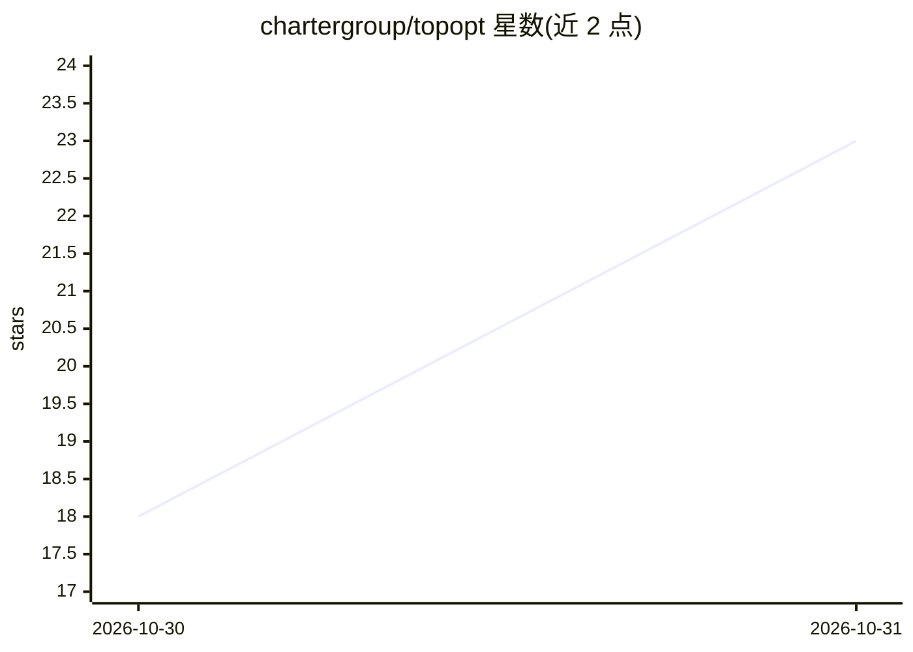

# chartergroup/topopt

⭐ 23 · Python · MIT · 推送 2026-10-29 · [GitHub](https://github.com/chartergroup/topopt) · [官网](https://topopt.ai) · 组织维护

**供 AI agent 调用的拓扑优化 MCP 服务器：输入载荷与区域，输出可打印 STL**

以 MCP 服务器形式向 Claude、Codex、Cursor 等 AI agent 客户端提供 3D 打印拓扑优化能力：起点可以是已有 STL、草图或纯文字描述，经有限元拓扑优化（如 200 轮迭代）找到承载载荷的轻量形状，输出光滑 STL 与质量/刚度指标，并带本地 dashboard 展示运行过程。运行于 macOS Apple silicon 与 Linux x86_64，需 16 GB 内存；通过 Claude Desktop 安装包、Claude Code 插件命令或 git clone 通用 MCP 方式安装，首次运行自动下载约 200 MB（uv/Python 3.13/依赖包）。项目自标 Status: early。

## 筛选速览

| 维度 | 判定 | 备注 |
|---|---|---|
| AI 角色 | `ai-ecosystem` | LLM/agent 周边工具 |
| 许可风险 | `permissive` | MIT |
| 部署形态 | `library` | 以包/库形式分发 |
| 模型依赖 | locked-api |  |
| 硬件要求 | — | 无带数字的原话,不猜 |
| 安装摩擦 | `low` | 无编译、无系统依赖或容器化 |
| 成熟度 | `idea` | |

## 能力要点

- 支持 STL 文件、草图或纯文字三种起始输入方式
- 输出光滑 STL、metrics.json（质量/刚度/耗时）与渲染图片
- 本地 dashboard 展示形状、体积与柔度变化，支持录制回放
- 兼容任何支持 MCP 的客户端（Claude Desktop/Claude Code/Codex CLI/Cursor/VS Code/Gemini CLI）

## 适用场景

- 让 AI agent 帮我把现有支架减重并生成可打印 STL
- 用一句话描述零件与载荷，直接得到拓扑优化结果
- 在 3D 打印前做打印检查与应力校核

## 场景标签

 · 领域:工程仿真/生成式设计

## 证据(README 行号)

> L10:  topopt is an MCP server for topology optimization that works with Claude, Codex, Cursor and other AI agents.
> L12: It gives your AI agent a topology optimizer that sets itself up and runs on your own computer. The start part can b

## 星数曲线

2026-10-30 18 → 2026-10-31 23（+5）

---
*卡片 v1 · prompt 1.4 · 生成 2026-10-30 · 置信度 mid · 依据 README sha `1095b85827ce` · [字段定义](../../DATASET.md)*
