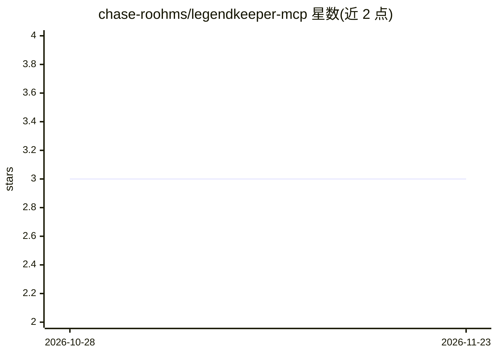

# chase-roohms/legendkeeper-mcp

⭐ 3 · Python · MIT · 推送 2026-11-18 · [GitHub](https://github.com/chase-roohms/legendkeeper-mcp) · [官网](https://pypi.org/project/legendkeeper-mcp/) · 个人维护

**让 AI 助手读写 LegendKeeper TTRPG 世界观的非官方 MCP 服务器**

一个非官方 MCP 服务器，通过 LegendKeeper 官方 v3 REST API 让 Claude、Copilot、Cursor 等 AI 助手读取与构建跑团世界观：页面以 Markdown 双向转换（保留 callout、GM 秘密、折叠段落、infobox 等）、infobox 事实、地图标注、时间线、标签与图片上传。提供 31 个工具、批量创建（≤100）、区段级编辑与 If-Match 版本检查。支持 stdio 与带 Bearer token 的 HTTP 两种传输，含只读模式、多世界配置与删除确认机制。前提是项目所有者持有付费版 LegendKeeper。

## 筛选速览

| 维度 | 判定 | 备注 |
|---|---|---|
| AI 角色 | `ai-ecosystem` | LLM/agent 周边工具 |
| 许可风险 | `permissive` | MIT |
| 部署形态 | `self-host` | docker 或自建部署 |
| 模型依赖 | — | README 未给出锁定关系 |
| 硬件要求 | — | 无带数字的原话,不猜 |
| 安装摩擦 | `low` | 无编译、无系统依赖或容器化 |
| 成熟度 | — | 结构信号不足 |

## 能力要点

- 31 个面向 LLM 的工具，另有 api_request 逃生口覆盖其余 v3 端点
- Markdown 双向转换，无法表达的块以 verbatim 区域保留
- If-Match 版本检查与幂等键防止并发丢失与重试重复创建
- 只读模式、删除确认与 Docker compose 安全加固

## 适用场景

- 用自然语言让 AI 助手创建酒馆页面、地图钉与时间线事件
- 批量生成相互链接的世界观资源（最多 100 个）
- 以只读模式让 AI 检索跑团 wiki 内容
- 通过 Docker Compose 为多个客户端提供长期 HTTP 服务

## 场景标签

`AI 助手` · 领域:对话与助手

## 证据(README 行号)

> L11: An MCP server that lets AI assistants (Claude, Copilot, Cursor, …) read and
> L29: - **31 curated tools** designed for LLMs. Resources accept names as well as ids, and errors explain how to fix
> L42: - **Two transports**: stdio for desktop clients, or a long-running Docker container serving streamable HTTP

## 星数曲线

2026-10-28 3 → 2026-11-23 3（+0）

---
*卡片 v1 · prompt 1.4 · 生成 2026-11-22 · 置信度 mid · 依据 README sha `a6d5774cbc5f` · [字段定义](../../DATASET.md)*
