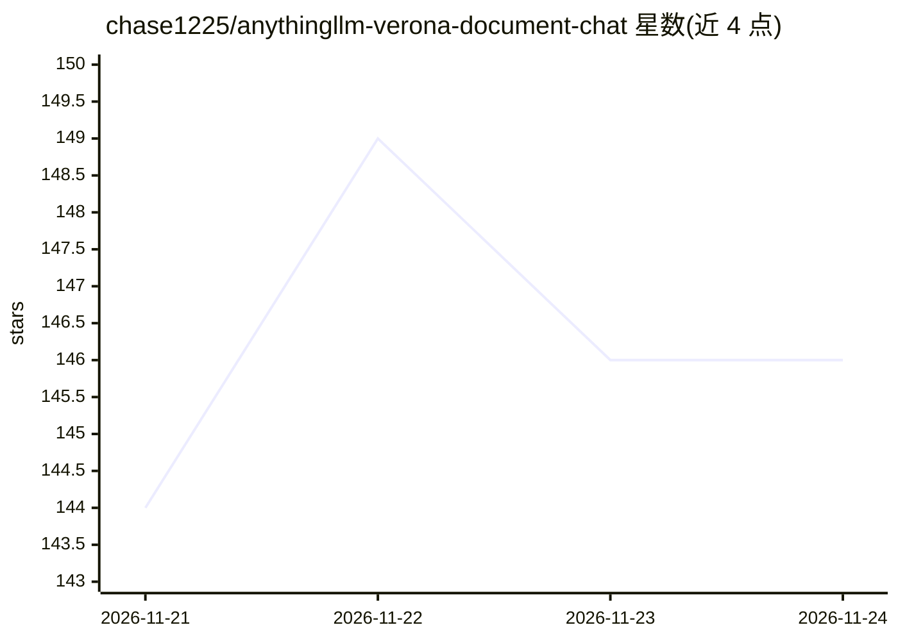

# chase1225/anythingllm-verona-document-chat

⭐ 146 · Python · MIT · 推送 2026-11-22 · [GitHub](https://github.com/chase1225/anythingllm-verona-document-chat) · 个人维护

**面向本地文档问答的桌面客户端，回答附带来源引文**

一个以本地优先方式运行的知识库对话桌面应用：将用户导入的文档解析、分块、嵌入并写入本地向量库，查询时检索相关片段交由配置的语言模型生成带来源引用的回答。支持多工作区隔离、批量导入与增量索引、持久会话历史、跨文档对比提问，以及回答严格度、回复语言等控制项。遥测默认关闭，数据存于本地目录；搭配本地推理后端可离线运行，配置远程后端时会传输查询上下文。README 仅给出 Windows PowerShell 安装路径。

## 筛选速览

| 维度 | 判定 | 备注 |
|---|---|---|
| AI 角色 | `ai-native` | 本体是模型或模型工具 |
| 许可风险 | `permissive` | MIT |
| 部署形态 | `None` |  |
| 模型依赖 | — | README 未给出锁定关系 |
| 硬件要求 | `cpu-ok` | |
| 安装摩擦 | `low` | 无编译、无系统依赖或容器化 |
| 成熟度 | — | 结构信号不足 |

## 能力要点

- 文档摄取管线：解析、分块、嵌入与增量索引
- 回答附来源引文，可打开被引原文核对
- 多工作区隔离，各工作区独立向量库与会话历史
- 模型与嵌入后端可配置，支持本地或远程推理服务

## 适用场景

- 对本地文档集做带引文核对的问答
- 对比规划文档两个版本的改动并逐点溯源
- 跨多个会话持续推进大型文档集的审阅

## 场景标签

`文档问答` `RAG` · 领域:知识与检索

## 证据(README 行号)

> L12: Anythingllm Verona Document Chat is a desktop application for interacting with local document collections through a
> L29: - **Retrieval-augmented responses**: Answers are grounded in retrieved passages from the active workspace's indexed
> L31: - **Source citation and traceability**: Chat responses include references to the originating document chunks, allow

## 星数曲线

2026-11-21 144 → 2026-11-24 146（+2）

---
*卡片 v1 · prompt 1.4 · 生成 2026-11-21 · 置信度 mid · 依据 README sha `d62a14e64bb7` · [字段定义](../../DATASET.md)*
