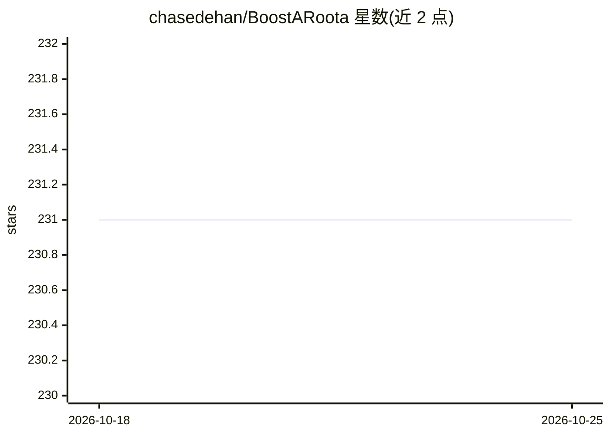

# chasedehan/BoostARoota

⭐ 231 · Python · MIT · 推送 2026-06-30 · [GitHub](https://github.com/chasedehan/BoostARoota) · 个人维护

**基于 XGBoost 的快速特征选择算法库**

借鉴 Boruta 的影子特征思想并适配梯度提升的 Python 特征选择库：复制并随机打乱各列生成影子特征，训练 XGBoost（或其他带 feature_importances_ 的 sklearn 树模型）多轮，以影子重要性均值除以 cutoff 参数为阈值逐轮剔除特征，直至单轮剔除比例低于 delta 或达到 max_rounds。API 遵循 fit/transform 风格，输入须为数值型 pandas DataFrame，分类变量需自行 one-hot 编码；多分类仅支持 mlogloss 指标。

## 筛选速览

| 维度 | 判定 | 备注 |
|---|---|---|
| AI 角色 | `ai-native` | 本体是模型或模型工具 |
| 许可风险 | `permissive` | MIT |
| 部署形态 | `library` | 以包/库形式分发 |
| 模型依赖 | — | README 未给出锁定关系 |
| 硬件要求 | — | 无带数字的原话,不猜 |
| 安装摩擦 | `low` | 无编译、无系统依赖或容器化 |
| 成熟度 | — | 结构信号不足 |

## 能力要点

- 影子特征对照的多轮迭代式特征剔除
- 默认基于 XGBoost，可传入任意带 feature_importances_ 的 sklearn 树模型
- fit / keep_vars_ / transform 的 sklearn 风格 API
- cutoff、iters、delta、max_rounds 等可调参数

## 适用场景

- 高维表格数据上为 XGBoost/树模型做特征选择
- 在使用 sklearn 流程的项目中嵌入自动化降维步骤
- 对比真实特征与随机影子特征判断特征有效性

## 场景标签

 · 领域:机器学习/特征工程

## 证据(README 行号)

> L3: A fast, practical feature selection algorithm built on XGBoost — with support for other scikit-learn tree-based mode
> L7: BoostARoota takes the core idea from Boruta — compare real features against randomized "shadow" features — and adapt

## 星数曲线

2026-10-18 231 → 2026-10-25 231（+0）

---
*卡片 v1 · prompt 1.4 · 生成 2026-10-22 · 置信度 high · 依据 README sha `de4d6db13833` · [字段定义](../../DATASET.md)*
