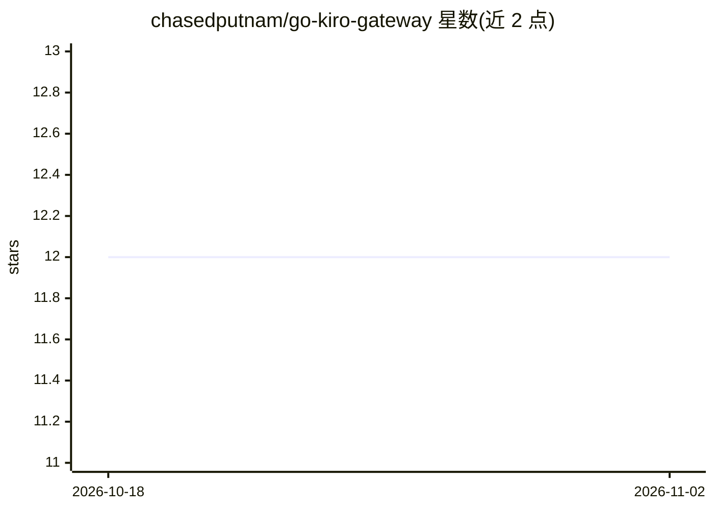

# chasedputnam/go-kiro-gateway

⭐ 12 · HTML · AGPL-3.0 · 推送 2026-10-26 · [GitHub](https://github.com/chasedputnam/go-kiro-gateway) · 个人维护

**把 Kiro（Amazon Q）模型转成 OpenAI/Anthropic 兼容 API 的网关**

用 Go 编写的 API 网关代理，复用 Kiro 登录凭证（Amazon Q Developer / AWS CodeWhisperer）访问 Claude、DeepSeek、Qwen 等模型，对外暴露 OpenAI 兼容接口与 Anthropic 原生 /v1/messages 端点，供 Claude Code、Cursor、Codex 等工具接入。支持 HTTP 直连（凭证文件/环境变量/AWS SSO/SQLite 四种凭证方式）与 ACP 模式（通过本地 kiro-cli 子进程，免凭证）。提供预编译二进制、源码编译与 Docker 部署；ACP 模式不支持 Docker。

## 筛选速览

| 维度 | 判定 | 备注 |
|---|---|---|
| AI 角色 | `ai-ecosystem` | LLM/agent 周边工具 |
| 许可风险 | `viral` | AGPL-3.0 |
| 部署形态 | `desktop` | 安装包/桌面程序 |
| 模型依赖 | — | README 未给出锁定关系 |
| 硬件要求 | — | 无带数字的原话,不猜 |
| 安装摩擦 | `low` | 无编译、无系统依赖或容器化 |
| 成熟度 | — | 结构信号不足 |

## 能力要点

- OpenAI 兼容 API 与 Anthropic 原生 /v1/messages 端点
- ACP 模式通过 kiro-cli 子进程通信，无需 API 凭证
- 四种凭证来源：JSON 文件、环境变量、AWS SSO、kiro-cli SQLite
- SSE 流式、工具调用、视觉输入、自动重试与 token 自动刷新

## 适用场景

- 在 Claude Code、Cursor、OpenCode 等工具中使用 Kiro 账号下的模型
- 把 Kiro 接入任意 OpenAI/Anthropic 兼容 SDK 或 LangChain 应用
- 用 Docker 自建代理统一管理 Kiro 凭证与访问密码

## 场景标签

`模型网关` · 领域:Agent 开发

## 证据(README 行号)

> L3: **An API gateway proxy for the AWS Kiro Service (Amazon Q Developer / AWS CodeWhisperer)**
> L12: *Use LLM models from Kiro with Claude Code, OpenCode, Codex app, Cursor, Pi, Crush, Obsidian, OpenAI SDK, LangChain
> L46: |**OpenAI-compatible API**|Works with any OpenAI-compatible tool|

## 星数曲线

2026-10-18 12 → 2026-11-02 12（+0）

---
*卡片 v1 · prompt 1.4 · 生成 2026-11-01 · 置信度 high · 依据 README sha `ceaf185665cb` · [字段定义](../../DATASET.md)*
