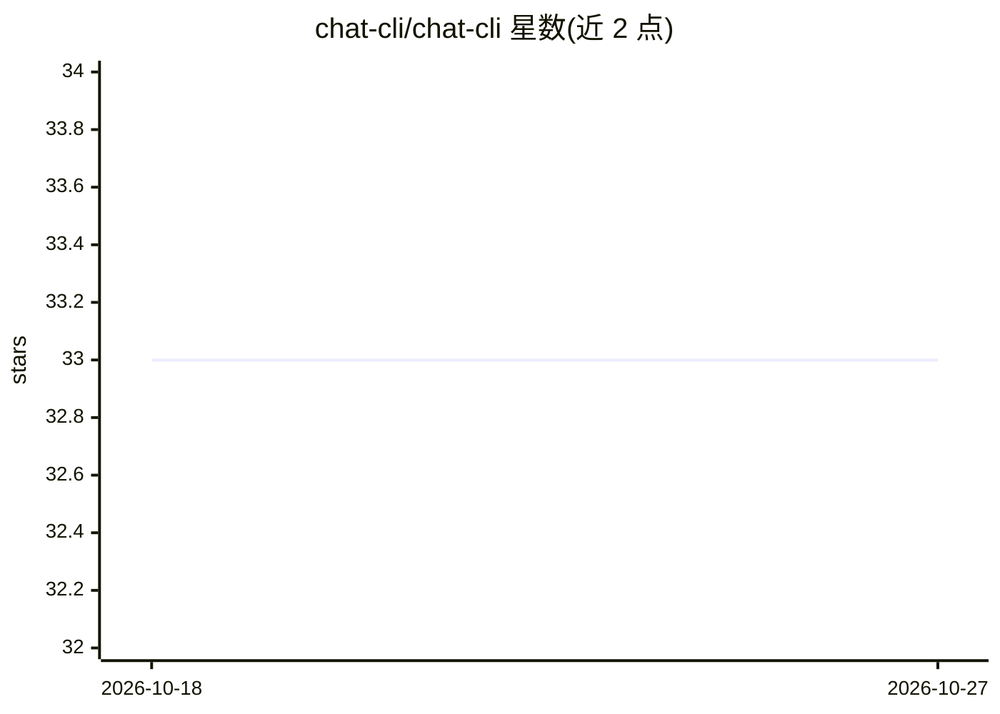

# chat-cli/chat-cli

⭐ — · [GitHub]() · 组织维护

**终端里调用 Amazon Bedrock 上 LLM 的命令行聊天客户端**

Go 编写的终端程序，通过 Amazon Bedrock 访问文本大模型，提供三种交互方式：单次 prompt、交互式 chat（会话保存到本地 sqlite 可恢复）、image 图像生成。支持配置默认模型与自定义 ARN、自动发现项目上下文文件（AGENTS.md/CLAUDE.md 等）作为系统提示、工具调用（read_file）、提示缓存、扩展思考模式、流式响应及图片/文档附件。需要 AWS 账号、在 Bedrock 启用模型并用 AWS CLI 配置凭证。提供预编译二进制与 Homebrew 安装。

## 筛选速览

| 维度 | 判定 | 备注 |
|---|---|---|
| AI 角色 | `ai-ecosystem` | LLM/agent 周边工具 |
| 许可风险 | `permissive` | — |
| 部署形态 | `library` | 以包/库形式分发 |
| 模型依赖 | locked-api |  |
| 硬件要求 | — | 无带数字的原话,不猜 |
| 安装摩擦 | `low` | 无编译、无系统依赖或容器化 |
| 成熟度 | — | 结构信号不足 |

## 能力要点

- prompt/chat/image 三种命令，chat 会话保存至本地 sqlite 并可恢复
- 自动发现 AGENTS.md/CLAUDE.md 等项目上下文文件作为系统提示
- 支持工具调用（read_file）、提示缓存、扩展思考、流式响应
- 支持图片（png/jpg <5MB）与文档（PDF/CSV/DOC 等）附件

## 适用场景

- 在终端与 Bedrock 上的大模型对话或发单次提问
- 用命令行生成图像或对代码/文档提问
- 在项目中携带上下文文件与模型对话

## 场景标签

`聊天机器人` `图像生成` · 领域:对话与助手

## 证据(README 行号)

> L3: A little terminal based program that lets you interact with LLMs available via Amazon Bedrock.
> L68: There are currently three ways to interact with foundation models through this interface.
> L260: Currently all text based LLMs available through Amazon Bedrock are supported. The LLMs you wish to use must be ena

## 星数曲线

2026-10-18 33 → 2026-10-27 33（+0）

---
*卡片 v1 · prompt 1.4 · 生成 2026-10-25 · 置信度 high · 依据 README sha `1ec911bf27f2` · [字段定义](../../DATASET.md)*
