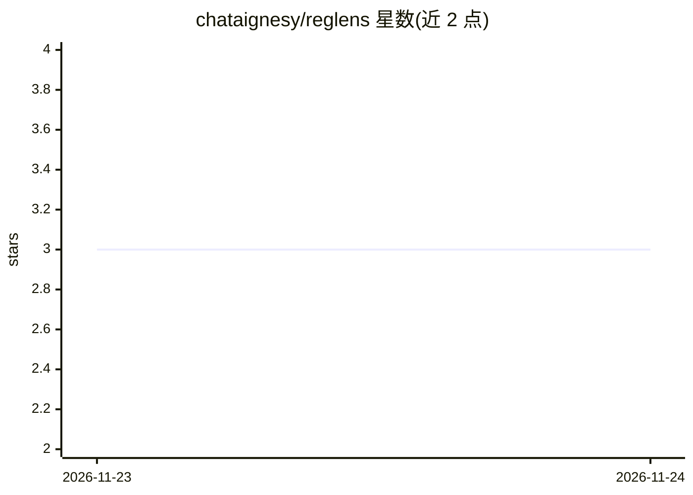

# chataignesy/reglens

⭐ 3 · Python · MIT · 推送 2026-11-22 · [GitHub](https://github.com/chataignesy/reglens) · 个人维护

**面向欧盟信用风险监管的带引用 RAG 问答助手**

针对 CRR3、RTS、EBA 指南与 ECB 指南等欧盟信用风险监管文本的本地问答系统：从官方来源摄取文本，按法律层级切分为条款段落单元；检索融合 Postgres 全文关键词与 BGE-M3 嵌入并经交叉编码器重排；简单问题走单次检索回答，多步问题交给有上限 10 次工具调用的 agent；回答前由代码机械核验每条声明是否引用给定片段且数字出现在其中。语料工具另以 MCP server 形式提供。无托管 demo，需本地运行；个人开源项目，声明非法律建议。

## 筛选速览

| 维度 | 判定 | 备注 |
|---|---|---|
| AI 角色 | `ai-native` | 本体是模型或模型工具 |
| 许可风险 | `permissive` | MIT |
| 部署形态 | `self-host` | docker 或自建部署 |
| 模型依赖 | locked-api |  |
| 硬件要求 | — | 无带数字的原话,不猜 |
| 安装摩擦 | `low` | 无编译、无系统依赖或容器化 |
| 成熟度 | — | 结构信号不足 |

## 能力要点

- 每条声明附条款引用，标注法律/监管期望/解释层级与文本'as of'日期
- 代码机械核验声明引用与数字出现后再呈现回答
- 路由机制：简单问题单查，多步问题走有界（≤10 工具调用）research agent
- 语料工具以 MCP server 暴露，Claude Desktop 等 MCP 客户端可直查监管文本

## 适用场景

- 查询 IRB 方法、标准化方法或违约定义的监管条文出处
- 验证监管政策文档与法规条款的覆盖缺口（义务登记对照矩阵）
- 作为 MCP server 让本地客户端直接查询监管语料

## 场景标签

`聊天机器人` `RAG` · 领域:对话与助手

## 证据(README 行号)

> L3: **Ask EU credit risk regulation a question and get an answer you can check:** every claim
> L59: 1. **Ingestion from official sources:** the law via the EU Publications Office API (consolidated
> L163: Answers are generated with your **Claude subscription** (the `claude` CLI must be installed and

## 星数曲线

2026-11-23 3 → 2026-11-24 3（+0）

---
*卡片 v1 · prompt 1.4 · 生成 2026-11-23 · 置信度 high · 依据 README sha `635cb05e38bd` · [字段定义](../../DATASET.md)*
