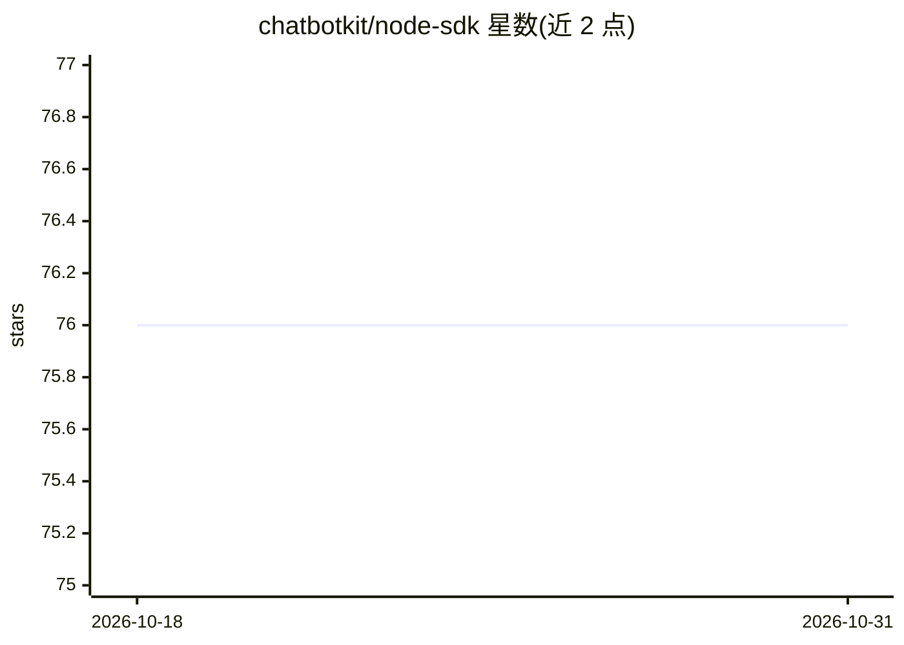

# chatbotkit/node-sdk

⭐ 76 · JavaScript · 推送 2026-10-27 · [GitHub](https://github.com/chatbotkit/node-sdk) · [官网](https://chatbotkit.com) · 组织维护

**ChatBotKit 官方 JS/TS SDK 套件：构建会话 AI 应用**

面向 JavaScript/TypeScript/React/Next.js 开发者的 ChatBotKit 平台官方 SDK 元仓库，包含 API SDK、Agent SDK、React/Next.js/NextAuth SDK、Widget 与 CLI 等 8 个 npm 包，另有 create-cbk-app 应用脚手架工具。AI 编排（模型调用、工具执行）在 ChatBotKit 服务端完成，本地代码保持轻量；平台侧支持 OpenAI、Anthropic、Mistral 等多厂商模型与 Slack/Discord/WhatsApp 集成。README 声明所有 SDK 功能默认视为 unstable，除非标注 @stable。

## 筛选速览

| 维度 | 判定 | 备注 |
|---|---|---|
| AI 角色 | `ai-ecosystem` | LLM/agent 周边工具 |
| 许可风险 | `none` | — |
| 部署形态 | `library` | 以包/库形式分发 |
| 模型依赖 | — | README 未给出锁定关系 |
| 硬件要求 | — | 无带数字的原话,不猜 |
| 安装摩擦 | `low` | 无编译、无系统依赖或容器化 |
| 成熟度 | `idea` | |

## 能力要点

- 8 个 npm 包覆盖 CLI、API、Agent、React、Next.js、NextAuth、Widget、fetch
- AI 编排与模型调用在 ChatBotKit 服务端执行
- 支持 Serverless、Edge、Cloudflare Workers、Deno、AWS Lambda 等运行时
- 内置流式对话、函数调用与多平台消息渠道集成示例

## 适用场景

- 在 Next.js 应用中接入 ChatBotKit 构建流式聊天机器人
- 通过 React SDK 在网页嵌入可定制聊天组件
- 将聊天机器人接入 Slack、Discord、WhatsApp 等消息平台

## 场景标签

`Agent 框架` `聊天机器人` · 领域:Agent 开发

## 证据(README 行号)

> L14: The official JavaScript and TypeScript SDK suite for
> L17: with custom data, skillsets, and integrations while keeping AI orchestration on
> L64: - **Serverless Compatibility**: Works seamlessly with modern runtime environments like Serverless, Edge, Vercel, Ne

## 星数曲线

2026-10-18 76 → 2026-10-31 76（+0）

---
*卡片 v1 · prompt 1.4 · 生成 2026-10-24 · 置信度 high · 依据 README sha `e583c5cc874a` · [字段定义](../../DATASET.md)*
