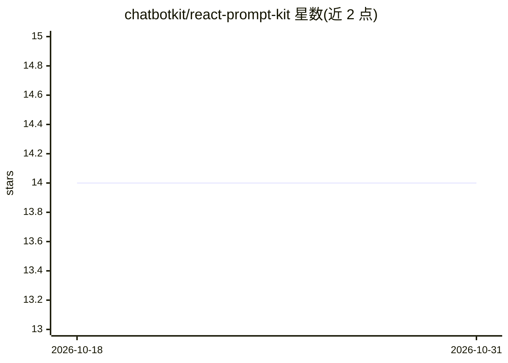

# chatbotkit/react-prompt-kit

⭐ 14 · TypeScript · MIT · 推送 2026-10-20 · [GitHub](https://github.com/chatbotkit/react-prompt-kit) · 组织维护

**用 JSX 构建结构化 LLM 提示词的 React 组件库**

面向使用 React/TypeScript 的 LLM 应用开发者的提示词构建工具库：以 JSX 组件（如 Instructions、Context、Task 等 50+ 个）声明式组装提示词，通过 prompt() 函数渲染为 XML 标签与 Markdown 混合的文本供大模型使用。组件设计参考 Claude 的 XML 标签实践；内联元素自动剥离 XML 标签并规范化空白以防注入，代码块自动转义反引号。以 npm 包分发，提供 TypeScript 类型定义与示例脚本。

## 筛选速览

| 维度 | 判定 | 备注 |
|---|---|---|
| AI 角色 | `ai-ecosystem` | LLM/agent 周边工具 |
| 许可风险 | `permissive` | MIT |
| 部署形态 | `library` | 以包/库形式分发 |
| 模型依赖 | — | README 未给出锁定关系 |
| 硬件要求 | — | 无带数字的原话,不猜 |
| 安装摩擦 | `low` | 无编译、无系统依赖或容器化 |
| 成熟度 | — | 结构信号不足 |

## 能力要点

- prompt() 函数将 JSX/React 元素渲染为 Markdown 与 XML 结构化文本
- 50+ 预置组件对应常见提示词模式（instructions/context/task/thinking 等）
- 内联元素剥离 XML 标签并规范化空白，防止 XML 注入
- 代码块自动延长围栏转义反引号

## 适用场景

- 在 React 项目中以组件方式维护复杂提示词
- 生成带 XML 标签结构的结构化提示词供任意 LLM 使用
- 对含用户输入的提示词做注入防护

## 场景标签

`提示工程` · 领域:Agent 开发

## 证据(README 行号)

> L9: A React-based toolkit for building structured prompts using JSX, inspired by Claude's XML tags best practices.
> L13: Traditional prompt strings become hard to maintain as soon as they mix instructions, examples, and formatting rules
> L64: The library provides a `prompt()` function that converts JSX/React elements to Markdown, and a set of prompt engine

## 星数曲线

2026-10-18 14 → 2026-10-31 14（+0）

---
*卡片 v1 · prompt 1.4 · 生成 2026-10-31 · 置信度 high · 依据 README sha `2c6dfc33462a` · [字段定义](../../DATASET.md)*
