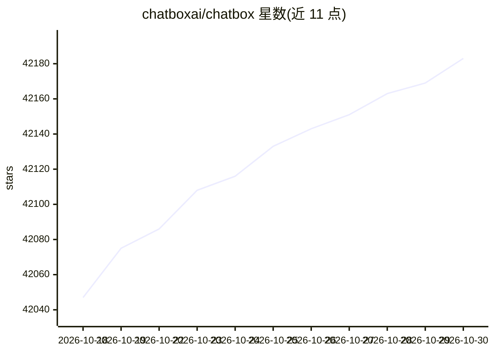

# chatboxai/chatbox

⭐ 42,183 · TypeScript · GPL-3.0 · 推送 2026-10-29 · [GitHub](https://github.com/chatboxai/chatbox) · [官网](https://chatboxai.app?utm_medium=github) · 组织维护 · 中文 README

**面向桌面/移动端用户的多模型 AI 聊天客户端**

Chatbox 社区版是一个开源（GPLv3）的桌面 AI 客户端，支持接入多家 LLM 服务（OpenAI、Azure OpenAI、Claude、Gemini、Ollama、ChatGLM-6B 等），提供本地数据存储、Dall-E-3 图像生成、Markdown/LaTeX 渲染、流式回复、提示词库、团队 API 共享、多语言界面等。覆盖 Windows/macOS/Linux 桌面端及 iOS/Android/Web。仓库与商业 pro 版定期双向同步代码，非完全独立演进。

## 筛选速览

| 维度 | 判定 | 备注 |
|---|---|---|
| AI 角色 | `ai-enhanced` | 去掉 AI 部分产品仍成立 |
| 许可风险 | `dual` | GPL-3.0 |
| 部署形态 | `desktop` | 安装包/桌面程序 |
| 模型依赖 | local-ok | 支持本地模型 |
| 硬件要求 | — | 无带数字的原话,不猜 |
| 安装摩擦 | `low` | 无编译、无系统依赖或容器化 |
| 成熟度 | — | 结构信号不足 |

## 动量与使用信号

- 维护:`active` — 距上次 push 23.7 天,年发版 17,71 位贡献者
- 涨星:近 1 天 **+15**(自 20261016 起算)
- 下载:GitHub Release 附件 累计 514,792(65 个 release)
- 平台:WINDOWS / MACOS / LINUX / ANDROID / IOS · 协议:OPENAI-API / OLLAMA

## 能力要点

- 支持多家 LLM 提供商：OpenAI、Azure OpenAI、Claude、Gemini、Ollama 本地模型、ChatGLM-6B
- 数据本地存储，提供桌面、Web、iOS/Android 多端形态
- Dall-E-3 图像生成、Markdown/LaTeX 渲染、流式回复、提示词库
- GPLv3 开源社区版，与 pro 仓库定期同步代码

## 适用场景

- 在桌面端统一使用多个 LLM 服务聊天
- 通过 Ollama 访问本地模型以保持数据不外发
- 团队内共享 OpenAI API 资源协作

## 场景标签

`聊天机器人` `AI 助手` · 领域:对话与助手

## 证据(README 行号)

> L7:  Your Ultimate AI Copilot on the Desktop. Chatbox is a desktop client for ChatGPT, Claude and other LLMs, available 
> L35: This is the repository for the Chatbox Community Edition, open-sourced under the GPLv3 license.
> L105: - **Support for Multiple LLM Providers**

## 星数曲线

2026-10-18 42,047 → 2026-10-30 42,183（+136）

---
*卡片 v1 · prompt 1.4 · 生成 2026-10-18 · 置信度 mid · 依据 README sha `8e19c358b53e` · [字段定义](../../DATASET.md)*
